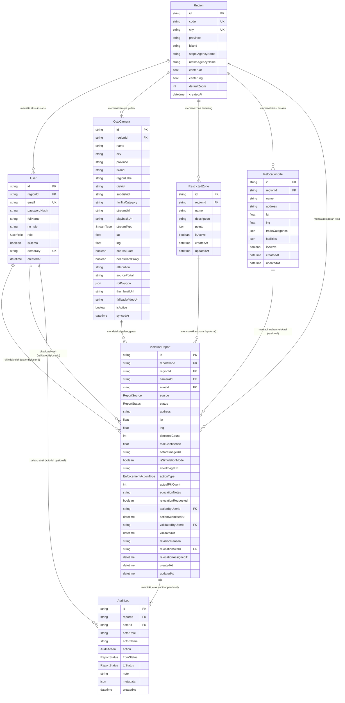

> **Aturan Agen AI:** Dilarang menambah, mengganti nama, atau menghapus field, enum, dan endpoint di luar dokumen ini tanpa persetujuan eksplisit user. Jika fitur butuh perubahan kontrak, berhenti dan tanyakan dulu.

# PHASE 3B — DATA CONTRACT & SINGLE SOURCE OF TRUTH (`PATRA`)

> **Produk:** `PATRA (Pantauan Transparan Ruang Publik)`  
> **Fungsi Dokumen:** _Single Source of Truth_ mutlak bagi Dev 1 (Fullstack), Dev 2 (AI & CCTV), Dev 3 (UI/UX & QA), dan AI Coding Agent untuk **Skema Prisma PostgreSQL**, **Kontrak REST API Express**, **Skema JSON Katalog CCTV Publik**, **Interface `<CctvPlayerWithAI />`**, dan **Sample Seed Data**.  
> **Status Dokumen:** Draft Phase 3 — Menunggu Tinjauan & Persetujuan (_Stop-Gate_)

---

## 1. Entity-Relationship Diagram (ERD)



### Penjelasan Ringkas 7 Entitas Inti

1. **`Region`:** Master kabupaten/kota (kunci _Region-Locked_ `city`), koordinat pusat peta, dan nama instansi dinamis (`umkmAgencyName`, mis. _Suku Dinas PPKUKM Jakarta Pusat_ vs _Dinas Koperasi dan UKM Kota Semarang_).
2. **`User`:** Akun pemerintah (`SATPOL_PP` / `DINAS_UMKM`) terikat ke 1 `regionId`, mendukung login standar (`passwordHash`) dan 1-Click Demo (`isDemo`, `demoKey`).
3. **`CctvCamera`:** Katalog kamera publik _pre-synced_ dari `indonesia_sources.py` (ID mengikuti format sumber, mis. `jkt_035_JKP_POLRI_UOB_PLAZA_C01`), lengkap dengan `roiPolygon` ternormalisasi opsional (`0..1`) dan `fallbackVideoUrl`.
4. **`RestrictedZone`:** Poligon zona terlarang per kota (GeoJSON `[lng, lat][]`) yang dikelola Satpol PP dan ditampilkan di Peta Publik & Operasional.
5. **`RelocationSite`:** Lokasi Binaan resmi yang dikelola Dinas UMKM (**tanpa kolom kuota/kapasitas** sesuai _Strict Out-of-Scope_), mendukung _soft-archive_ (`isActive = false`).
6. **`ViolationReport`:** Entitas insiden pelanggaran tunggal (`1 laporan NEED_ACTION aktif per cameraId`) dari deteksi hingga validasi, relokasi, dan Berita Acara PDF.
7. **`AuditLog`:** Jejak audit **append-only** (tidak memiliki kolom `updatedAt` dan tidak memiliki endpoint ubah/hapus) untuk mencatat seluruh transisi status, alasan revisi, dan pengarsipan URL snapshot _Before_ sebelumnya saat terjadi _Incident Escalation_.

---

## 2. File `schema.prisma` Lengkap & Siap Dijalankan

Lokasi target: `BE-Patra/prisma/schema.prisma` (Prisma v7 + `@prisma/adapter-pg` dengan konfigurasi URL di `BE-Patra/prisma.config.ts`).

```prisma
// PATRA — Prisma Schema (PostgreSQL / Supabase Pooler)
// URL koneksi dikelola via apps/api/prisma.config.ts (DATABASE_URL pooler :6543, DIRECT_URL :5432 untuk migrate)

generator client {
  provider = "prisma-client"
  output   = "../generated/prisma"
}

datasource db {
  provider = "postgresql"
}

enum UserRole {
  SATPOL_PP
  DINAS_UMKM
}

enum StreamType {
  hls
  mjpeg
  mp4
}

enum ReportSource {
  AUTO_AI
  MANUAL
}

enum ReportStatus {
  NEED_ACTION
  PENDING_VALIDATION
  NEEDS_REVISION
  VALIDATED
}

enum EnforcementActionType {
  EDUCATION_WARNING
  ADMINISTRATIVE_ACTION
  RELOCATION_ASSISTANCE
}

enum AuditAction {
  REPORT_CREATED
  INCIDENT_ESCALATED
  MANUAL_EVIDENCE_UPDATED
  ACTION_SUBMITTED
  REVISION_REQUESTED
  REVISION_SUBMITTED
  REPORT_VALIDATED
  RELOCATION_ASSIGNED
}

model Region {
  id               String            @id @default(uuid())
  code             String            @unique // mis. "jkt-pusat", "semarang"
  city             String            @unique // Exact match dengan CctvCamera.city, mis. "Kota Jakarta Pusat"
  province         String
  island           String            @default("Jawa")
  satpolAgencyName String            // mis. "Satpol PP Kota Administrasi Jakarta Pusat"
  umkmAgencyName   String            // mis. "Suku Dinas PPKUKM Jakarta Pusat" / "Dinas Koperasi & UKM Kota Semarang"
  centerLat        Float
  centerLng        Float
  defaultZoom      Int               @default(13)
  createdAt        DateTime          @default(now())

  users            User[]
  cameras          CctvCamera[]
  zones            RestrictedZone[]
  relocationSites  RelocationSite[]
  reports          ViolationReport[]

  @@index([province])
}

model User {
  id               String            @id @default(uuid())
  regionId         String
  region           Region            @relation(fields: [regionId], references: [id], onDelete: Restrict)
  email            String            @unique
  passwordHash     String
  fullName         String
  noTelp           String?           @map("no_telp")
  role             UserRole
  isDemo           Boolean           @default(false)
  demoKey          String?           @unique // mis. "satpol-jkt-pusat", "dinas-jkt-pusat"
  createdAt        DateTime          @default(now())

  actionedReports  ViolationReport[] @relation("ReportActionedBy")
  validatedReports ViolationReport[] @relation("ReportValidatedBy")
  auditLogs        AuditLog[]

  @@index([regionId, role])
}

model CctvCamera {
  id               String            @id // ID deterministik dari katalog, mis. "jkt_035_JKP_POLRI_UOB_PLAZA_C01"
  regionId         String
  region           Region            @relation(fields: [regionId], references: [id], onDelete: Restrict)
  name             String
  city             String
  province         String
  island           String            @default("Jawa")
  regionLabel      String            // field "region" dari katalog JSON (kelurahan, kecamatan, kota, provinsi)
  district         String?
  subdistrict      String?
  facilityCategory String?
  streamUrl        String
  playbackUrl      String
  streamType       StreamType        @default(hls)
  lat              Float
  lng              Float
  coordsExact      Boolean           @default(false)
  needsCorsProxy   Boolean           @default(false)
  attribution      String
  sourcePortal     String
  // Poligon ROI ternormalisasi [[x, y], ...] dengan rentang 0..1; null = fallback FULL_FRAME
  roiPolygon       Json?
  thumbnailUrl     String?
  fallbackVideoUrl String?           // mis. "/videos/demo-jakarta.mp4"
  isActive         Boolean           @default(true)
  syncedAt         DateTime          @default(now())

  reports          ViolationReport[]

  @@index([regionId, isActive])
  @@index([city, isActive])
  @@index([district])
}

model RestrictedZone {
  id          String            @id @default(uuid())
  regionId    String
  region      Region            @relation(fields: [regionId], references: [id], onDelete: Restrict)
  name        String
  description String?
  // GeoJSON ring terbuka [[lng, lat], ...] minimal 3 titik (divalidasi Turf.js anti self-intersecting)
  points      Json
  isActive    Boolean           @default(true)
  createdAt   DateTime          @default(now())
  updatedAt   DateTime          @updatedAt

  reports     ViolationReport[]

  @@index([regionId, isActive])
}

model RelocationSite {
  id              String            @id @default(uuid())
  regionId        String
  region          Region            @relation(fields: [regionId], references: [id], onDelete: Restrict)
  name            String
  address         String
  lat             Float
  lng             Float
  // Array string kategori dagangan, mis. ["Kuliner", "Minuman", "Kerajinan"]
  tradeCategories Json
  // Array string fasilitas, mis. ["Listrik", "Air Bersih", "Toilet", "Parkir"] — TANPA KUOTA
  facilities      Json
  isActive        Boolean           @default(true)
  createdAt       DateTime          @default(now())
  updatedAt       DateTime          @updatedAt

  reports         ViolationReport[]

  @@index([regionId, isActive])
}

model ViolationReport {
  id                   String                 @id @default(uuid())
  reportCode           String                 @unique // mis. "PTR-202611-0001"
  regionId             String
  region               Region                 @relation(fields: [regionId], references: [id], onDelete: Restrict)
  cameraId             String
  camera               CctvCamera             @relation(fields: [cameraId], references: [id], onDelete: Restrict)
  zoneId               String?
  zone                 RestrictedZone?        @relation(fields: [zoneId], references: [id], onDelete: SetNull)

  source               ReportSource           @default(AUTO_AI)
  status               ReportStatus           @default(NEED_ACTION)
  address              String
  lat                  Float
  lng                  Float

  // Data deteksi (Before) — menerapkan Peak Active Count saat Incident Merging
  detectedCount        Int                    @default(1)
  maxConfidence        Float                  @default(0.0)
  beforeImageUrl       String
  isSimulationMode     Boolean                @default(false)

  // Data penindakan Satpol PP (After)
  afterImageUrl        String?
  actionType           EnforcementActionType?
  actualPklCount       Int?
  educationNotes       String?
  relocationRequested  Boolean                @default(false)
  actionByUserId       String?
  actionByUser         User?                  @relation("ReportActionedBy", fields: [actionByUserId], references: [id], onDelete: SetNull)
  actionSubmittedAt    DateTime?

  // Data validasi & relokasi Dinas UMKM
  validatedByUserId    String?
  validatedByUser      User?                  @relation("ReportValidatedBy", fields: [validatedByUserId], references: [id], onDelete: SetNull)
  validatedAt          DateTime?
  revisionReason       String?
  relocationSiteId     String?
  relocationSite       RelocationSite?        @relation(fields: [relocationSiteId], references: [id], onDelete: SetNull)
  relocationAssignedAt DateTime?

  createdAt            DateTime               @default(now())
  updatedAt            DateTime               @updatedAt

  auditLogs            AuditLog[]

  // Optimasi Incident Merging & Cooldown lookup
  @@index([cameraId, status, createdAt(sort: Desc)])
  @@index([cameraId, actionSubmittedAt(sort: Desc)])
  // Optimasi Dashboard, Portal Publik & Filter Laporan per Kota
  @@index([regionId, status, createdAt(sort: Desc)])
  @@index([regionId, relocationRequested, status])
}

// APPEND-ONLY IMMUTABLE AUDIT TRAIL (SDG 16)
// Dilarang memiliki kolom updatedAt maupun operasi UPDATE/DELETE di lapisan service/API.
model AuditLog {
  id         String        @id @default(uuid())
  reportId   String
  report     ViolationReport @relation(fields: [reportId], references: [id], onDelete: Restrict)
  actorId    String?
  actor      User?         @relation(fields: [actorId], references: [id], onDelete: SetNull)
  actorRole  String        // "SYSTEM_AI" | "SATPOL_PP" | "DINAS_UMKM"
  actorName  String        // Snapshot nama instansi/petugas saat kejadian
  action     AuditAction
  fromStatus ReportStatus?
  toStatus   ReportStatus
  note       String?
  // Menyimpan data preservasi bukti, mis. { previousBeforeImageUrl, previousCount, newCount, revisionReason, relocationSiteName }
  metadata   Json?
  createdAt  DateTime      @default(now())

  @@index([reportId, createdAt(sort: Asc)])
  @@index([createdAt(sort: Desc)])
}
```

---

## 3. Kontrak REST API Express

### 3.1 Konvensi Global

- **Base URL:** `/api` (di luar `/health` dan `/health/db`).
- **Format Sukses:** `{ "ok": true, "data": { ... }, "meta": { ... } }`
- **Format Error:** `{ "ok": false, "error": { "code": "ERROR_CODE", "message": "Pesan bahasa Indonesia yang jelas", "details": [] } }`
- **Header Auth (Endpoint Terproteksi):** `Authorization: Bearer <jwt_token>`.
- **Kode HTTP Standar:** `200 OK`, `201 Created`, `400 Bad Request` (Zod/validasi), `401 Unauthorized`, `403 Forbidden` (Role/Region-Lock), `404 Not Found`, `409 Conflict` (_race condition_ status), `413 Payload Too Large` (> 4 MB), `500 Internal Server Error`.

### 3.2 Ringkasan Seluruh Endpoint

| Grup         | Method & Path                                                      | Akses                     | Cache / Keterangan                                                                              |
| :----------- | :----------------------------------------------------------------- | :------------------------ | :---------------------------------------------------------------------------------------------- |
| **Health**   | `GET /health`, `GET /health/db`                                    | Publik                    | Diagnostik Vercel & Supabase Pooler                                                             |
| **Auth**     | `POST /api/auth/login`                                             | Publik                    | Login email + password                                                                          |
| **Auth**     | `POST /api/auth/demo-login`                                        | Publik                    | Panel Akses Demo 1-Klik (`demoKey`)                                                             |
| **Auth**     | `GET /api/auth/me`                                                 | Auth                      | Profil akun, `role`, `noTelp`, `region` & label instansi                                        |
| **Auth**     | `PATCH /api/auth/me`                                               | Auth                      | Perbarui `noTelp` (`no_telp`) profil akun sendiri                                               |
| **Auth**     | `POST /api/auth/logout`                                            | Auth                      | Konfirmasi logout klien                                                                         |
| **Publik**   | `GET /api/public/cities`                                           | Publik                    | Daftar kota aktif (`s-maxage=900`)                                                              |
| **Publik**   | `GET /api/public/overview?city=`                                   | Publik                    | 4 KPI _real-time_ per kota (atau semua kota)                                                    |
| **Publik**   | `GET /api/public/map?city=`                                        | Publik                    | Poligon zona + _hotspot_ (**tanpa foto**) + Lokasi Binaan                                       |
| **Publik**   | `GET /api/public/audit-feed?city=&limit=20`                        | Publik                    | Linimasa Akuntabilitas per ruas jalan                                                           |
| **CCTV**     | `GET /api/cctv`                                                    | `SATPOL_PP`               | Katalog metadata CCTV sesuai `req.user.city` (`s-maxage=900, SWR=60`)                           |
| **CCTV**     | `GET /api/cctv/:id`                                                | `SATPOL_PP`               | Detail 1 kamera + `roiPolygon` + status tiket aktif (`403` jika beda kota)                      |
| **CCTV**     | `PATCH /api/cctv/:id/roi`                                          | `SATPOL_PP`               | Simpan/update `roiPolygon` ternormalisasi `0..1` (opsional kalibrasi)                           |
| **Zona**     | `GET /api/zones`                                                   | `SATPOL_PP`, `DINAS_UMKM` | Daftar Poligon Zona Terlarang kota akun                                                         |
| **Zona**     | `POST /api/zones`, `PATCH /api/zones/:id`, `DELETE /api/zones/:id` | `SATPOL_PP`               | CRUD Poligon Zona (validasi Turf.js)                                                            |
| **Laporan**  | `POST /api/reports/auto-detect`                                    | `SATPOL_PP`               | _Auto-Capture_ & _Manual Capture_ (_Incident Merging_ + _Peak Active Count_)                    |
| **Laporan**  | `GET /api/reports`                                                 | `SATPOL_PP`, `DINAS_UMKM` | Daftar laporan kota akun (filter `status`, `relocationRequested`, `search`, `page`, `pageSize`) |
| **Laporan**  | `GET /api/reports/:id`                                             | `SATPOL_PP`, `DINAS_UMKM` | Detail laporan + `auditLogs` + **3 `nearestRelocationSites`**                                   |
| **Laporan**  | `POST /api/reports/:id/action`                                     | `SATPOL_PP`               | Submit foto _After_ + jenis tindakan + pengajuan relokasi (`409` guarded)                       |
| **Validasi** | `POST /api/reports/:id/validate`                                   | `DINAS_UMKM`              | Setujui (`VALIDATED`) atau Tolak/Revisi (`NEEDS_REVISION`, wajib alasan)                        |
| **Relokasi** | `POST /api/reports/:id/relocation`                                 | `DINAS_UMKM`              | Penetapan Lokasi Binaan 1-Klik pada laporan `VALIDATED`                                         |
| **PDF**      | `GET /api/reports/:id/pdf`                                         | `DINAS_UMKM`, `SATPOL_PP` | Stream Berita Acara PDF 1 Halaman A4 (`?inline=1` untuk preview; hanya `VALIDATED`)             |
| **Analitik** | `GET /api/dinas/analytics`                                         | `DINAS_UMKM`              | 4 KPI, tren 30 hari, _peak hours_ WIB, top 5 jalan, peta penataan (**tanpa pin CCTV**)          |
| **Binaan**   | `GET /api/relocation-sites`                                        | `DINAS_UMKM`, `SATPOL_PP` | Daftar Lokasi Binaan aktif kota akun                                                            |
| **Binaan**   | `POST /api/relocation-sites`, `PATCH /:id`, `DELETE /:id`          | `DINAS_UMKM`              | CRUD Lokasi Binaan (_click-to-pin_, tanpa kuota; delete = hard/soft-archive)                    |

### 3.3 Contoh Payload Request / Response / Error Kritis

#### A. Auth & 1-Click Demo Login (`POST /api/auth/demo-login`)

```json
// Request
{
  "demoKey": "satpol-jkt-pusat"
}

// Response 200 OK
{
  "ok": true,
  "data": {
    "token": "eyJhbGciOiJIUzI1NiIsInR5cCI6IkpXVCJ9...",
    "user": {
      "id": "u-satpol-jkp",
      "email": "satpol.jakpus@patra.demo",
      "fullName": "Petugas Piket Satpol PP Jakarta Pusat",
      "role": "SATPOL_PP",
      "isDemo": true,
      "region": {
        "id": "reg-jkp",
        "code": "jkt-pusat",
        "city": "Kota Jakarta Pusat",
        "province": "DKI Jakarta",
        "satpolAgencyName": "Satpol PP Kota Administrasi Jakarta Pusat",
        "umkmAgencyName": "Suku Dinas PPKUKM Jakarta Pusat",
        "centerLat": -6.186486,
        "centerLng": 106.834091,
        "defaultZoom": 13
      }
    }
  }
}
```

#### B. Portal Publik (`GET /api/public/overview?city=Kota%20Jakarta%20Pusat` & `GET /api/public/map`)

```json
// GET /api/public/overview -> 200 OK
{
  "ok": true,
  "data": {
    "city": "Kota Jakarta Pusat",
    "kpi": {
      "totalViolationsThisMonth": 24,
      "resolutionRatePercent": 75.0,
      "avgResponseSlaMinutes": 42,
      "totalPklDirectedToRelocation": 19
    }
  }
}

// GET /api/public/map?city=Kota%20Jakarta%20Pusat -> 200 OK (PERHATIKAN: TIDAK ADA FIELD FOTO MENTAH!)
{
  "ok": true,
  "data": {
    "region": { "city": "Kota Jakarta Pusat", "centerLat": -6.186486, "centerLng": 106.834091, "defaultZoom": 13 },
    "zones": [
      { "id": "z-1", "name": "Trotoar Thamrin - Sudirman", "points": [[106.821, -6.193], [106.825, -6.193], [106.825, -6.202], [106.821, -6.202]] }
    ],
    "hotspots": [
      {
        "id": "rep-001",
        "reportCode": "PTR-202611-0001",
        "address": "Jl. M.H. Thamrin (UOB Plaza), Kebon Melati, Tanah Abang",
        "lat": -6.2005,
        "lng": 106.8229,
        "detectedCount": 2,
        "status": "VALIDATED",
        "createdAt": "2026-11-22T02:15:00.000Z"
      }
    ],
    "relocationSites": [
      {
        "id": "site-jkp-1",
        "name": "Lokasi Binaan JP 37 Thamrin City",
        "address": "Jl. Thamrin Boulevard, Kebon Melati, Tanah Abang",
        "lat": -6.1944,
        "lng": 106.8195,
        "tradeCategories": ["Kuliner", "Minuman", "Pakaian"],
        "facilities": ["Listrik", "Air Bersih", "Toilet", "Area Teduh"]
      }
    ]
  }
}
```

#### C. Auto-Detect & Manual Capture — _Incident-Based Merging_ (`POST /api/reports/auto-detect`)

Dikirim sebagai `multipart/form-data`:

- Field `snapshot`: File JPEG terkompresi (`≤ 1,5 MB`, batas keras Multer `4 MB`)
- Field `payload`: String JSON tervalidasi Zod:

```json
{
  "cameraId": "jkt_035_JKP_POLRI_UOB_PLAZA_C01",
  "source": "AUTO_AI",
  "currentActiveViolators": 3,
  "maxConfidence": 0.87,
  "isSimulationMode": false
}
```

- **Response Skenario 1 (`201 Created` — Incident Baru):**

```json
{
  "ok": true,
  "data": {
    "outcome": "CREATED",
    "merged": false,
    "escalated": false,
    "suppressedByCooldown": false,
    "report": {
      "id": "rep-101",
      "reportCode": "PTR-202611-0015",
      "cameraId": "jkt_035_JKP_POLRI_UOB_PLAZA_C01",
      "status": "NEED_ACTION",
      "detectedCount": 3,
      "beforeImageUrl": "https://<project>.supabase.co/storage/v1/object/public/patra-evidence/before/uuid.jpg",
      "createdAt": "2026-11-22T08:10:00.000Z"
    }
  }
}
```

- **Response Skenario 2 (`200 OK` — Merged & Escalated karena `currentActiveViolators > activeReport.detectedCount`):**
  `"outcome": "MERGED_ESCALATED", "merged": true, "escalated": true` (URL snapshot lama tersimpan di `AuditLog.metadata.previousBeforeImageUrl`).
- **Response Skenario 3 (`200 OK` — Merged No-Op karena `currentActiveViolators <= activeReport.detectedCount`):**
  `"outcome": "MERGED_NOOP", "merged": true, "escalated": false` (tidak mengunggah file ke Storage & tidak menulis `AuditLog`).
- **Response Skenario 4 (`200 OK` — Dalam Masa _Cooldown_ Pasca Penindakan):**
  `"outcome": "COOLDOWN_SUPPRESSED", "suppressedByCooldown": true, "cooldownRemainingSec": 21`.
- **Error `403 Forbidden` (Kamera di Luar Kota Akun):**

```json
{
  "ok": false,
  "error": {
    "code": "REGION_ACCESS_DENIED",
    "message": "Anda tidak memiliki akses ke kamera CCTV di luar wilayah tugas Anda."
  }
}
```

#### D. Submit Hasil Penindakan Satpol PP (`POST /api/reports/:id/action`)

`multipart/form-data`:

- Field `afterPhoto`: File JPEG/PNG/WebP (`≤ 4 MB`)
- Field `payload`: JSON string:

```json
{
  "actionType": "RELOCATION_ASSISTANCE",
  "actualPklCount": 2,
  "educationNotes": "Pedagang telah diedukasi secara persuasif terkait larangan berjualan di trotoar dan bersedia pindah ke Lokasi Binaan terdekat.",
  "relocationRequested": true
}
```

- **Response `200 OK`:** Mengembalikan laporan terbaru dengan `status: "PENDING_VALIDATION"`, `afterImageUrl`, `actionSubmittedAt`, dan entri `AuditLog` (`ACTION_SUBMITTED` atau `REVISION_SUBMITTED`).
- **Error `409 Conflict`:** Jika status laporan saat ini bukan `NEED_ACTION` / `NEEDS_REVISION`:

```json
{
  "ok": false,
  "error": {
    "code": "REPORT_STATUS_CONFLICT",
    "message": "Laporan ini sudah ditindaklanjuti atau statusnya telah berubah. Silakan muat ulang halaman."
  }
}
```

#### E. Validasi Dinas UMKM (`POST /api/reports/:id/validate`) & Penetapan Relokasi 1-Klik (`POST /api/reports/:id/relocation`)

```json
// POST /api/reports/:id/validate (Approve)
{ "decision": "APPROVE" }

// POST /api/reports/:id/validate (Request Revision)
{
  "decision": "REQUEST_REVISION",
  "revisionReason": "Foto bukti After terlalu gelap dan belum memperlihatkan area trotoar sudah bersih."
}

// POST /api/reports/:id/relocation (1-Klik pada laporan VALIDATED & relocationRequested=true)
{
  "relocationSiteId": "site-jkp-1"
}
```

#### F. Dashboard Analitik Dinas UMKM (`GET /api/dinas/analytics`)

```json
{
  "ok": true,
  "data": {
    "kpi": {
      "totalIncomingReports": 32,
      "validatedPercent": 78.1,
      "avgResponseSlaMinutes": 38,
      "totalRelocationDirected": 14
    },
    "dailyTrend": [
      { "date": "2026-11-20", "count": 4 },
      { "date": "2026-11-21", "count": 6 }
    ],
    "peakHoursWib": [
      { "hour": 8, "label": "08:00", "count": 5 },
      { "hour": 17, "label": "17:00", "count": 9 }
    ],
    "topHotspotStreets": [
      {
        "address": "Jl. M.H. Thamrin (UOB Plaza), Kebon Melati",
        "count": 7,
        "validatedCount": 6
      }
    ],
    "planningMap": {
      "validatedPoints": [
        {
          "id": "rep-001",
          "lat": -6.2005,
          "lng": 106.8229,
          "address": "Jl. M.H. Thamrin",
          "weight": 3
        }
      ],
      "relocationSites": [
        {
          "id": "site-jkp-1",
          "name": "Lokasi Binaan JP 37 Thamrin City",
          "lat": -6.1944,
          "lng": 106.8195,
          "address": "...",
          "facilities": ["Listrik", "Air Bersih"]
        }
      ]
    }
  }
}
```

_(Perhatikan: `planningMap` **tidak pernah menyertakan** array `cameras` sesuai `LOCKED DECISION`.)_

---

## 4. Kontrak Skema Katalog CCTV Publik (Multi-Kota)

### 4.1 Format JSON Standar (`AI-Patra/cctv_catalog/cctv_snapshot.json`)

Disesuaikan langsung dengan output `indonesia_sources.py`, ditambah field opsional `roi_polygon`, `thumbnail_url`, dan `fallback_video_url`:

```json
{
  "id": "jkt_035_JKP_POLRI_UOB_PLAZA_C01",
  "name": "JKP POLRI UOB PLAZA C01",
  "city": "Kota Jakarta Pusat",
  "province": "DKI Jakarta",
  "island": "Jawa",
  "region": "Kebon Melati, Tanah Abang, Kota Jakarta Pusat, DKI Jakarta",
  "stream_url": "https://dki-jkt.balitower.co.id:7028/504866_JKP_POLRI_UOB-PLAZA-C01_CCTV-03/index.m3u8",
  "stream_type": "hls",
  "lat": -6.210377,
  "lng": 106.864629,
  "coords_exact": false,
  "needs_cors_proxy": false,
  "attribution": "Diskominfotik DKI Jakarta (JakCCTV)",
  "source_portal": "https://jakcctv.jakarta.go.id/publik",
  "district": "Tanah Abang",
  "subdistrict": "Kebon Melati",
  "facility_category": "Pasar & Pusat Belanja",
  "playback_url": "https://dki-jkt.balitower.co.id:7028/504866_JKP_POLRI_UOB-PLAZA-C01_CCTV-03/index.m3u8",
  "roi_polygon": [
    [0.08, 0.55],
    [0.92, 0.55],
    [0.98, 0.96],
    [0.02, 0.96]
  ],
  "fallback_video_url": "/videos/demo-jakarta.mp4",
  "thumbnail_url": null
}
```

### 4.2 Aturan Pemetaan & Playback (`LOCKED DECISION`)

1. **_Region-Locked Matching_:** Skrip _sync_ memetakan field `city` (string ternormalisasi _trim_) ke `Region.city` di Supabase. Saat akun Satpol PP login, `GET /api/cctv` hanya mengembalikan kamera dengan `regionId === req.user.regionId`.
2. **Pemanfaatan `needs_cors_proxy`:**
   - Kamera dengan `needs_cors_proxy: false` dan protokol `https://` diputar langsung di browser via `hls.js` menggunakan `playback_url || stream_url` tanpa membebani Vercel serverless.
   - Kamera dengan `needs_cors_proxy: true` atau `http://` di lingkungan HTTPS langsung menandai _prefer fallback_ (atau melewati percobaan cepat 5 detik lalu masuk Mode Simulasi lokal agar tidak memicu _mixed content_ / CORS error).
3. **_Auto-Fallback_ 5 Detik:** Jika `hls.js` gagal mencapai event `MANIFEST_PARSED` / `video` gagal memutar dalam **5000 ms**, atau memicu `FATAL` error / `SecurityError` (_tainted canvas_), pemutar otomatis memuat `fallback_video_url` (default `/videos/demo-jakarta.mp4` atau `/videos/demo-semarang.mp4` berdasarkan kota) dengan `loop` aktif dan lencana status **"Live CCTV Offline — Mode Simulasi"**.
4. **Poligon ROI Opsional (`roi_polygon`):** Array minimal 3 pasangan `[x, y]` ternormalisasi `0.0..1.0`. Bila `null`/kosong → otomatis _Full-Frame_ tanpa error.

---

## 5. Kontrak Integrasi Frontend ↔ AI (`<CctvPlayerWithAI />`)

Lokasi interface: `FE-Patra/src/types/cctvPlayer.ts` (digunakan bersama oleh Dev 1 di `FE-Patra/src/pages/feat-cctv/CctvLivePage.tsx` dan Dev 2 di `FE-Patra/src/components/cctv/CctvPlayerWithAI.tsx`, dengan kontrak backend sepadan di `BE-Patra/src/interface/cctv.interface.ts`).

```ts
export type NormalizedPoint = [number, number]; // [x, y] dalam rentang 0..1
export type NormalizedPolygon = NormalizedPoint[];

export type TrackerLifecycleState =
  | "OBSERVING"
  | "REPORTED"
  | "SUPPRESSED"
  | "CLEARED";

export type CctvStreamStatus =
  | "INITIALIZING"
  | "LIVE_HLS"
  | "SIMULATION_FALLBACK"
  | "ERROR";

export interface CctvCameraDto {
  id: string;
  name: string;
  city: string;
  province: string;
  regionLabel: string;
  district: string | null;
  subdistrict: string | null;
  facilityCategory: string | null;
  streamUrl: string;
  playbackUrl: string;
  streamType: "hls" | "mjpeg" | "mp4";
  lat: number;
  lng: number;
  coordsExact: boolean;
  needsCorsProxy: boolean;
  attribution: string;
  sourcePortal: string;
  roiPolygon: NormalizedPolygon | null;
  thumbnailUrl: string | null;
  fallbackVideoUrl: string | null;
  hasActiveReport?: boolean;
}

export interface TrackedObjectOverlay {
  trackId: number;
  className: string; // "PKL" / "gerobak"
  confidence: number;
  /** Koordinat bbox ternormalisasi 0..1 */
  bboxNorm: { x1: number; y1: number; x2: number; y2: number };
  inRoi: boolean;
  state: TrackerLifecycleState;
  dwellSeconds: number;
}

export interface ViolationCapturePayload {
  cameraId: string;
  source: "AUTO_AI" | "MANUAL";
  /** Jumlah total PKL berstatus REPORTED/SUPPRESSED aktif bersamaan di ROI */
  currentActiveViolators: number;
  maxConfidence: number;
  isSimulationMode: boolean;
  /** Snapshot JPEG terkompresi (<= 1.5 MB) siap dikirim via FormData */
  snapshotBlob: Blob;
  capturedAtIso: string;
}

export interface CctvLiveTelemetry {
  streamStatus: CctvStreamStatus;
  aiBackend: "webgpu" | "wasm" | null;
  inferenceMs: number | null;
  inRoiCount: number;
  maxDwellSeconds: number;
  activeViolatorsCount: number;
  tracks: TrackedObjectOverlay[];
}

export interface CctvPlayerWithAIProps {
  camera: CctvCameraDto;
  /** Default: 15 (mode demo) atau 300 (operasional) dari VITE_VIOLATION_THRESHOLD_SEC */
  violationThresholdSec?: number;
  /** Default: 45 detik (rentang 30-60s) */
  occlusionGraceSec?: number;
  /** Default: 5000 ms */
  hlsTimeoutMs?: number;
  /** Callback tunggal ke parent (Dev 1) untuk memanggil POST /api/reports/auto-detect + tampilkan Toast */
  onViolationCaptured: (payload: ViolationCapturePayload) => Promise<{
    outcome:
      | "CREATED"
      | "MERGED_ESCALATED"
      | "MERGED_NOOP"
      | "COOLDOWN_SUPPRESSED";
    reportId?: string;
    reportCode?: string;
  }>;
  /** Opsional: melaporkan telemetri live ke bar status bawah video */
  onTelemetryChange?: (telemetry: CctvLiveTelemetry) => void;
}
```

> **Batas Tanggung Jawab Paralel Dev 1 vs Dev 2:**
>
> - **Dev 2** memiliki penuh `AI-Patra/*`, `FE-Patra/src/services/yolo/*`, dan `FE-Patra/src/components/cctv/CctvPlayerWithAI.tsx` (termasuk pemutar video penuh, canvas bbox + garis putus-putus ROI, kontrol _AI Detection ON/OFF_, _Show ROI ON/OFF_, _Fullscreen_, 1 bar aksi bersih di bawah video termasuk tombol _"Tangkap Bukti & Buat Laporan"_, serta auto-fallback 5 detik).
> - **Dev 1** menyediakan `camera: CctvCameraDto` dari TanStack Query dan mengimplementasikan callback `onViolationCaptured` untuk mengirim `FormData` ke `POST /api/reports/auto-detect` serta memicu _Toast Notification_ dan invalidasi cache laporan.

---

## 6. Sample Seed Data (2 Kota Pilot di Pulau Jawa)

Contoh data realistis yang akan diimplementasikan di `BE-Patra/prisma/seed.ts` (idempoten, aman dijalankan berulang):

### 6.1 `Region` (2 Kota Pilot)

```json
[
  {
    "code": "jkt-pusat",
    "city": "Kota Jakarta Pusat",
    "province": "DKI Jakarta",
    "island": "Jawa",
    "satpolAgencyName": "Satpol PP Kota Administrasi Jakarta Pusat",
    "umkmAgencyName": "Suku Dinas PPKUKM Jakarta Pusat",
    "centerLat": -6.186486,
    "centerLng": 106.834091,
    "defaultZoom": 13
  },
  {
    "code": "semarang",
    "city": "Kota Semarang",
    "province": "Jawa Tengah",
    "island": "Jawa",
    "satpolAgencyName": "Satpol PP Kota Semarang",
    "umkmAgencyName": "Dinas Koperasi dan Usaha Mikro Kota Semarang",
    "centerLat": -6.984049,
    "centerLng": 110.409582,
    "defaultZoom": 13
  }
]
```

### 6.2 `User` (4 Akun Demo 1-Klik)

| `demoKey`          | `role`       | `city`               | `email`                      | `fullName`                          |
| :----------------- | :----------- | :------------------- | :--------------------------- | :---------------------------------- |
| `satpol-jkt-pusat` | `SATPOL_PP`  | `Kota Jakarta Pusat` | `satpol.jakpus@patra.demo`   | Petugas Satpol PP Jakarta Pusat     |
| `dinas-jkt-pusat`  | `DINAS_UMKM` | `Kota Jakarta Pusat` | `sudin.jakpus@patra.demo`    | Admin Sudin PPKUKM Jakarta Pusat    |
| `satpol-semarang`  | `SATPOL_PP`  | `Kota Semarang`      | `satpol.semarang@patra.demo` | Petugas Satpol PP Kota Semarang     |
| `dinas-semarang`   | `DINAS_UMKM` | `Kota Semarang`      | `dinas.semarang@patra.demo`  | Admin Dinas Koperasi & UKM Semarang |

_(Password demo di-hash saat seeding menggunakan `bcryptjs`, tidak pernah diekspos ke frontend.)_

### 6.3 `CctvCamera` (Contoh Multi-Kota dari Katalog Publik)

- **Kota Jakarta Pusat (JakCCTV — `Diskominfotik DKI Jakarta`):**
  1. `jkt_035_JKP_POLRI_UOB_PLAZA_C01` — _JKP POLRI UOB PLAZA C01_ (`Tanah Abang`, `Pasar & Pusat Belanja`, `needs_cors_proxy: false`, `roiPolygon` trotoar depan plaza, `fallbackVideoUrl: "/videos/demo-jakarta.mp4"`).
  2. `jkt_041_JKP_PASAR_TANAH_ABANG_C02` — _JKP PASAR TANAH ABANG BLOK A_ (`Tanah Abang`, `Pasar & Pusat Belanja`, `roiPolygon` bahu jalan, `fallbackVideoUrl: "/videos/demo-jakarta.mp4"`).
  3. `jkt_052_JKP_STASIUN_GAMBIR_C01` — _JKP STASIUN GAMBIR SELATAN_ (`Gambir`, `Transportasi Publik`, `roiPolygon: null` untuk menguji _full-frame fallback_).
- **Kota Semarang (PantauSemar — `Diskominfo Kota Semarang`):**
  1. `smg_001_SIMPANG_LIMA_UTARA` — _SIMPANG LIMA SISI UTARA_ (`Semarang Tengah`, `Ruang Publik`, `needs_cors_proxy: false`, `roiPolygon` area pedestrian, `fallbackVideoUrl: "/videos/demo-semarang.mp4"`).
  2. `smg_008_PASAR_JOHAR_TIMUR` — _KORIDOR PASAR JOHAR TIMUR_ (`Semarang Tengah`, `Pasar & Pusat Belanja`, `roiPolygon` trotoar pasar, `fallbackVideoUrl: "/videos/demo-semarang.mp4"`).
  3. `smg_014_KOTA_LAMA_LETJEN_SUPRAPTO` — _KOTA LAMA JL. LETJEN SUPRAPTO_ (`Semarang Utara`, `Kawasan Wisata`, `roiPolygon: null`).
     _(Pada saat implementasi, seluruh katalog aktual dari `cctv_snapshot.json` hasil `indonesia_sources.py` akan di-upsert otomatis oleh skrip seed/sync)._

### 6.4 `RelocationSite` (3 Lokasi Binaan per Kota — Tanpa Kuota)

- **Kota Jakarta Pusat:**
  1. _Lokasi Binaan JP 37 Thamrin City_ (`-6.1944, 106.8195`, Kuliner/Minuman/Pakaian; Listrik, Air Bersih, Toilet, Area Teduh).
  2. _Sentra Binaan Kebon Kacang Raya_ (`-6.1912, 106.8178`, Kuliner/Jajanan; Listrik, Parkir, Kebersihan).
  3. _Lokasi Binaan JP 28 Pasar Baru_ (`-6.1652, 106.8342`, Kuliner/Kerajinan/Aksesori; Listrik, Air Bersih, Toilet).
- **Kota Semarang:**
  1. _Sentra Kuliner PKL Simpang Lima (Pujasera)_ (`-6.9905, 110.4234`, Kuliner/Minuman; Listrik, Air Bersih, Toilet, Parkir).
  2. _Selter PKL Kawasan Johar Baru_ (`-6.9721, 110.4258`, Kuliner/Sembako/Kerajinan; Listrik, Area Teduh, Kebersihan).
  3. _Selter PKL Taman Menteri Supeno_ (`-6.9936, 110.4198`, Kuliner/Jajanan; Listrik, Toilet, Lampu Penerangan).

### 6.5 `RestrictedZone`, `ViolationReport` & `AuditLog` (Seed Demo End-to-End)

Untuk setiap kota pilot, `seed.ts` menyiapkan:

- **2 `RestrictedZone`** (poligon area trotoar utama pusat kota & koridor pasar).
- **4 `ViolationReport`** yang mewakili seluruh status State Machine (`1 NEED_ACTION`, `1 PENDING_VALIDATION` dengan `relocationRequested: true`, `1 NEEDS_REVISION` lengkap dengan `revisionReason`, dan `1 VALIDATED` lengkap dengan `relocationSiteId` terpilih agar KPI Portal Publik, Grafik Dinas UMKM, dan Unduh PDF 1 Halaman langsung terisi dan dapat diuji juri sejak detik pertama).
- **Entri `AuditLog` kronologis lengkap** untuk masing-masing laporan sehingga _Public Audit Feed_ dan tabel jejak audit PDF langsung berjalan realistis.
