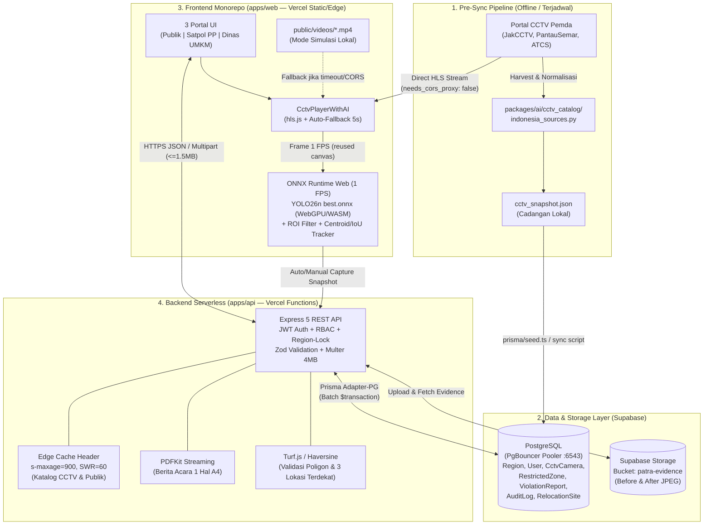
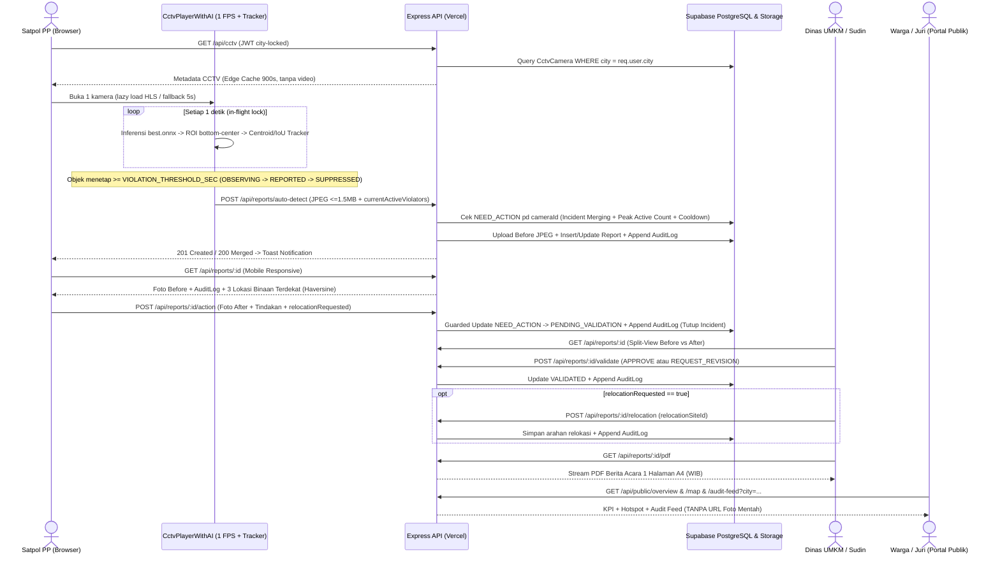

# PHASE 3A — SYSTEM ARCHITECTURE & ENGINEERING BLUEPRINT (`PATRA`)

> **Produk:** `PATRA (Pantauan Transparan Ruang Publik)`  
> **Dokumen Pendamping:** [.agent/rules/data_contract.md](../.agent/rules/data_contract.md) (Phase 3B — *Single Source of Truth* DB, API, JSON CCTV & AI Component) | [system_flow_redesign.md](./system_flow_redesign.md) (Phase 5 Revision)  
> **Prasyarat:** [legacy_audit.md](./legacy_audit.md) (Phase 1) & [requirement.md](./requirement.md) (Phase 2)  
> **Status Dokumen:** Phase 5 Revised — Lihat [system_flow_redesign.md](./system_flow_redesign.md) untuk Arsitektur Terbaru

> [!NOTE]
> **Revisi Phase 5 (Disetujui User):** Arsitektur sistem diperbarui tanpa mengubah struktur monorepo (`FE-Patra/`, `BE-Patra/`, `AI-Patra/`) maupun batasan PgBouncer/Vercel: (1) penambahan entitas `PatrolTeam` dengan *hard-lock* per kecamatan untuk `SATPOL_PP`, (2) kapasitas Lokasi Binaan + konsep *effective available capacity* (`maxCapacity - occupiedCapacity - pendingCapacity`), (3) algoritma relokasi otomatis **4 Tingkat Waterfall** (dengan *Split Darurat* sebagai cara terakhir melalui `ReportRelocationAllocation` dan commit kapasitas atomik via batch `prisma.$transaction([...])`), serta (4) perluasan endpoint analitik Sudin untuk monitoring tim dan okupansi selter. Rincian lengkap merujuk pada [system_flow_redesign.md](./system_flow_redesign.md) dan [data_contract.md](../.agent/rules/data_contract.md).

---

## 1. Prinsip Arsitektur & Struktur Monorepo

Arsitektur PATRA dirancang mengikuti prinsip **Anti-Overengineering**, **Zero GPU Server**, dan **1 Repository GitHub Monorepo** (`LOCKED DECISION`) agar realistis diselesaikan oleh **2 developer aktif + 1 UI/UX & QA Lead** sebelum deadline **18 Desember 2026**.

### 1.1 Struktur Folder Monorepo Lengkap (`LOCKED DECISION — UPDATED BY USER APPROVAL 22 NOV 2026`)

> **Catatan Perubahan Disetujui:** Mengikuti pola familiar tim (`Civision`) dan meminimalkan risiko *cross-workspace bundling* saat deployment Vercel, struktur folder monorepo ditetapkan menjadi **`FE-Patra/`**, **`BE-Patra/`**, dan **`AI-Patra/`** (Opsi 1 — tanpa folder `shared/` terpisah; kontrak tipe disinkronkan di `BE-Patra/src/interface/` dan `FE-Patra/src/types/` merujuk mutlak pada `.agent/rules/data_contract.md`).

```text
trio_wekwek/                          # Root GitHub Monorepo PATRA
├── package.json                      # Convenience scripts (install:all, dev:fe, dev:be, typecheck, build, test)
├── .gitignore                        # Mengabaikan node_modules/, dist/, .env*, _legacy_ref/, BE-Patra/generated/, AI-Patra/runs/
├── .agent/
│   └── rules/
│       └── data_contract.md          # Phase 3B (Single Source of Truth & Aturan Agen AI)
├── docs/
│   ├── legacy_audit.md               # Phase 1
│   ├── requirement.md                # Phase 2
│   ├── document.md                   # Phase 3A (dokumen ini)
│   └── task.md                       # Phase 4 (Sprint Roadmap)
│
├── AI-Patra/                         # Pelatihan YOLO26n high-angle, export/verify ONNX & katalog CCTV pre-sync
│   ├── README.md
│   ├── requirements.txt              # Bersih (ultralytics>=8.4, opencv-headless, numpy, requests)
│   ├── requirements-onnx.txt         # onnx, onnxruntime
│   ├── yolo.py                       # Fine-tuning YOLO26n sudut high-angle CCTV
│   ├── export_onnx.py                # Export opset=12, dynamic=False, inspeksi shape otomatis
│   ├── verify_onnx.py                # Parity check IoU best.pt vs best.onnx
│   ├── dataset/                      # Dataset high-angle CCTV
│   ├── model/                        # Master best.pt & best.onnx (disalin ke FE-Patra/public/models/)
│   └── cctv_catalog/
│       ├── indonesia_sources.py      # Skrip offline pemanen katalog JakCCTV, PantauSemar, dll.
│       └── cctv_snapshot.json        # Snapshot JSON cadangan lokal hasil pre-sync
│
├── FE-Patra/                         # React 18.3 + Vite + TS + Tailwind + shadcn/ui + Leaflet + Recharts + hls.js + ONNX
│   ├── package.json                  # Mandiri (bebas konflik workspace di Vercel)
│   ├── vite.config.ts                # optimizeDeps.exclude: ['onnxruntime-web']
│   ├── tailwind.config.ts            # Palet Cobalt Blue #043FA5, Cool Horizon #73A6E9, #F4F7FC, #0B132B
│   ├── components.json               # Konfigurasi shadcn/ui
│   ├── vercel.json                   # SPA rewrites (exclude /models/* dan /videos/*)
│   ├── public/
│   │   ├── models/best.onnx          # Disajikan statis oleh Vercel CDN
│   │   └── videos/                   # Video MP4 CCTV lokal untuk Auto-Fallback Mode Simulasi
│   │       ├── demo-jakarta.mp4
│   │       └── demo-semarang.mp4
│   └── src/
│       ├── main.tsx
│       ├── App.tsx                   # Route guards (Public, SATPOL_PP, DINAS_UMKM)
│       ├── assets/                   # Logo & aset grafis kustom PATRA
│       ├── lib/                      # utils.ts (cn), apiClient (Bearer JWT), queryClient, imageCompress, formatWib
│       ├── types/                    # DTO TypeScript FE (sesuai .agent/rules/data_contract.md)
│       ├── components/
│       │   ├── ui/                   # shadcn/ui primitives
│       │   ├── layout/               # AppShell (PublicHeader, SatpolSidebar 3 menu, DinasSidebar 3 menu)
│       │   ├── map/                  # Leaflet wrappers (PublicMap, SatpolOpsMap, DinasPlanningMap)
│       │   └── cctv/
│       │       └── CctvPlayerWithAI.tsx  # Komponen terisolasi milik Dev 2 (hls.js + ONNX + ROI + Tracker)
│       ├── services/
│       │   ├── auth/                 # login, demoLogin, me
│       │   ├── public/               # cities, overview, map, auditFeed
│       │   ├── cctv/                 # list, detail, roi
│       │   ├── zone/                 # CRUD zona terlarang
│       │   ├── report/               # autoDetect, list, detail, submitAction, validate, relocation, pdf
│       │   ├── dinas/                # analytics
│       │   ├── relocation/           # CRUD lokasi binaan
│       │   └── yolo/                 # config.ts, session.ts, preprocessing.ts, postprocessing.ts, yoloInference.ts, roi.ts, tracker.ts
│       └── pages/
│           ├── feat-public/          # PublicHomePage (KPI + Peta + Audit Feed)
│           ├── feat-login/           # LoginPage (+ 1-Click Demo Access)
│           ├── feat-cctv/            # CctvGridPage, CctvLivePage
│           ├── feat-maps/            # SatpolMapPage (3 layer + kelola zona)
│           ├── feat-reports/         # ReportsListPage, ReportDetailActionPage (Mobile-Responsive)
│           ├── feat-dinas-dashboard/ # DinasDashboardPage (Analitik + Peta Penataan tanpa pin CCTV)
│           ├── feat-validation/      # ValidationListPage, ValidationSplitPage (+ Relokasi 1-Klik + PDF)
│           └── feat-relocation/      # RelocationSitesPage (CRUD click-to-pin, tanpa kuota)
│
└── BE-Patra/                         # Node.js + Express 5 + TS + Prisma v7 + Supabase + Multer + Turf + PDFKit
    ├── package.json                  # Mandiri (pola deploy sama dengan BE-civision)
    ├── tsconfig.json
    ├── nodemon.json
    ├── vercel.json                   # @vercel/node + includeFiles: ["src/assets/**"]
    ├── prisma.config.ts              # Prisma v7 datasource config
    ├── api/
    │   └── index.ts                  # Serverless entrypoint untuk Vercel
    ├── prisma/
    │   ├── schema.prisma             # Single Source of Truth (lihat .agent/rules/data_contract.md)
    │   ├── migrations/
    │   └── seed.ts                   # Seed 2 kota pilot + sync AI-Patra/cctv_catalog/cctv_snapshot.json
    └── src/
        ├── index.ts                  # Express app + ipv4first + CORS whitelist + routes + errorHandler
        ├── assets/                   # Logo PATRA (PNG) untuk PDFKit Berita Acara
        ├── config/                   # config.ts, prisma.ts (global singleton + adapter-pg), supabase.ts
        ├── controller/               # auth, public, cctv, zone, report, dinas, relocationSite
        ├── interface/                # TypeScript DTO & Zod schemas (sesuai .agent/rules/data_contract.md)
        ├── middlewares/              # auth.ts (JWT + RBAC + RegionLock), validate.ts, upload.ts (4MB), logger.ts, errorHandler.ts, healthdb.ts
        ├── repository/               # Prisma data access layer
        ├── routes/                   # auth, public, cctv, zone, report, dinas, relocationSite, health
        └── service/                  # incidentMerge, slaAnalytics, geo (Haversine/Turf), pdfBeritaAcara, storage
```

### 1.2 Catatan Migrasi Scaffold Awal (`LOCKED DECISION — APPLIED`)
- Folder awal `frontend/` dan `backend/` telah dimigrasikan ke **`FE-Patra/`** (React `18.3.1` + Vite 6 + Tailwind v3 + shadcn/ui), **`BE-Patra/`** (Express 5 + TS ESM + struktur 8 sub-folder `src/`), dan **`AI-Patra/`**, serta `_legacy_ref/` telah masuk ke `.gitignore`.

---

## 2. Diagram Arsitektur Sistem & Alur Data (*Data Flow*)

### 2.1 High-Level System Architecture (`LOCKED DECISION`)



### 2.2 End-to-End Operational Sequence (`LOCKED DECISION`)



---

## 3. Desain Teknis Modul Inti

### 3.1 Pemetaan Poligon ROI Video vs Poligon Zona Peta (`LOCKED DECISION`)

Kedua poligon memiliki **sistem koordinat dan fungsi yang terpisah mutlak** (dilarang mencampur koordinat GPS dengan piksel video):

| Aspek | Poligon ROI Trotoar (`CctvCamera.roiPolygon`) | Poligon Zona Terlarang (`RestrictedZone.points`) |
| :--- | :--- | :--- |
| **Domain Koordinat** | **Ternormalisasi `[0..1, 0..1]`** relatif terhadap lebar & tinggi frame video (`(0,0)` kiri-atas, `(1,1)` kanan-bawah). | **Geografis GeoJSON `[lng, lat]`** (derajat WGS84) pada peta kota Leaflet. |
| **Fungsi Utama** | Memfilter deteksi `PKL` di atas frame CCTV agar hanya gerobak yang berada di area trotoar/bahu jalan yang dihitung melanggar. | Menampilkan area rawan/terlarang di Peta Publik & Peta Operasional Satpol PP (dan mencocokkan `zoneId` kamera/laporan). |
| **Algoritma Evaluasi** | Hitung **titik tengah bawah** *bounding box*: `nx = ((x1 + x2) / 2) / srcW`, `ny = y2 / srcH` → uji *Ray-Casting Point-in-Polygon* pada `roiPolygon`. | Validasi *self-intersecting* via `@turf/line-intersect` saat CRUD; uji titik kamera/laporan via `@turf/boolean-point-in-polygon`. |
| **Fallback** | Jika `roiPolygon` bernilai `null` atau `< 3` titik → otomatis **`FULL_FRAME`** (semua deteksi valid). | Opsional; laporan tetap dapat dibuat walau kamera berada di luar poligon zona (`zoneId = null`). |
| **Opsional Demo *High-Angle*** | Mendukung *ROI pre-crop* opsional (`roiCropEnabled`) khusus kamera sudut tinggi agar gerobak kecil tampak lebih besar di input 640×640 (`RECOMMENDATION`, default `false` agar sederhana). | — |

### 3.2 *Lightweight Centroid/IoU Tracker*, State Machine & Optimasi 1 FPS (`LOCKED DECISION`)

Diimplementasikan sebagai modul TypeScript murni tanpa dependensi berat di `packages/ai/src/tracker.ts`:

1. **Isolasi Multi-Kamera:** State disimpan dalam `Map<string, CameraTracker>` dengan kunci `cameraId`. Setiap kamera memiliki counter `nextTrackId`, daftar `tracks: Map<number, TrackedObject>`, dan `lastFrameAt`.
2. **Matching Antar-Frame (1 FPS):**
   - Untuk setiap deteksi valid (`confidence >= confThreshold` dan lolos uji ROI *bottom-center*):
   - Hitung skor asosiasi terhadap setiap *track* aktif:
     - `iouScore = iou(det.bboxNorm, track.bboxNorm)`
     - `distScore = Math.max(0, 1 - euclidean(det.bottomCenterNorm, track.bottomCenterNorm) / MAX_CENTROID_DIST)` (default `MAX_CENTROID_DIST = 0.15` dari dimensi frame).
     - `matchScore = 0.6 * iouScore + 0.4 * distScore` (diterima jika `iouScore >= 0.2` atau `distScore >= 0.5`).
   - Pasangan terbaik dicocokkan secara *greedy* (memadai untuk 1–15 gerobak per frame CCTV dengan kompleksitas $O(N \cdot M)$ sangat ringan).
3. **Transisi State Machine per `track_id`:**
   - Deteksi baru di dalam ROI → buat track dengan `state = 'OBSERVING'`, `firstSeenAt = now`, `lastSeenAt = now`.
   - Jika `state === 'OBSERVING'` dan `(now - firstSeenAt) >= VIOLATION_THRESHOLD_SEC * 1000`: ubah ke `state = 'REPORTED'`, hitung `currentActiveViolators` (jumlah seluruh track pada kamera ini yang berstatus `REPORTED` atau `SUPPRESSED` dan sedang terlihat atau masih dalam grace period), lalu panggil `onViolationCaptured(...)` **1 kali**.
   - Begitu callback pengiriman dipicu (atau sedang *in-flight*), track langsung pindah ke `state = 'SUPPRESSED'` (jika request jaringan gagal total, track boleh retry maksimal 1x setelah 10 detik, bukan spam setiap detik).
   - Jika suatu track tidak mendapatkan pasangan pada frame saat ini:
     - Untuk `OBSERVING`: hapus (`CLEARED`) bila `(now - lastSeenAt) >= OBSERVING_DROP_GRACE_SEC * 1000` (default `5 detik`, mencegah objek yang lewat terhitung ulang atau hilang karena 1 frame *flicker*).
     - Untuk `SUPPRESSED`: pertahankan selama `(now - lastSeenAt) < OCCLUSION_GRACE_SEC * 1000` (konfigurasi: **30–60 detik**, default `45 detik`), baru ubah ke `CLEARED` dan hapus dari `Map` setelah melewati grace period.
4. **Optimasi Performa Browser 1 FPS (Pelajaran dari Audit Phase 1):**
   - Alokasi `<canvas>` 640×640 dan `Float32Array(3 * 640 * 640)` **sekali saja** (reused per instance).
   - Gunakan `setTimeout` berantai + *in-flight lock* (`isInferring`) agar inferensi tidak pernah bertumpuk.
   - Selalu panggil `inputTensor.dispose?.()` **dan** `outputTensor.dispose?.()` di blok `finally` untuk mencegah kebocoran memori WebGPU.
   - Auto-detect output tensor shape (`[1, 300, 6]` end2end vs `[1, 4+nc, 8400]` legacy NMS) pada `postprocess.ts` agar kebal terhadap konflik format yang ditemukan pada Audit Phase 1.

### 3.3 Algoritma Lokasi Binaan Terdekat (`LOCKED DECISION`)

Dijalankan di backend (`apps/api/src/services/geo.service.ts`) menggunakan rumus **Haversine** (atau `@turf/distance`):
1. Query semua `RelocationSite` dengan `where: { regionId: report.regionId, isActive: true }`.
2. Hitung jarak `distanceMeters` dari `(report.lat, report.lng)` ke `(site.lat, site.lng)`.
3. Urutkan menaik berdasarkan `distanceMeters`, ambil `slice(0, 3)`.
4. Kembalikan `{ id, name, address, lat, lng, tradeCategories, facilities, distanceMeters, distanceLabel }` (**tanpa field kuota/kapasitas**).

### 3.4 Desain PDFKit Berita Acara 1 Halaman A4 (`LOCKED DECISION`)

Endpoint `GET /api/reports/:id/pdf` men-stream dokumen A4 (`595 × 842 pt`, margin `36 pt`) langsung via `doc.pipe(res)`:
- **Header (Cobalt Blue `#043FA5`):** Logo PATRA + Judul *"BERITA ACARA PENERTIBAN & ARAHAN RELOKASI PKL"* + Nama Instansi dinamis (`Region.umkmAgencyName` & `Satpol PP <city>`) + Nomor Laporan & Tanggal Cetak WIB.
- **Blok 1 — Ringkasan Kejadian & SLA (Grid 2 Kolom):** Lokasi/Kamera, Koordinat, Zona Terlarang, Jumlah PKL Terdeteksi vs Aktual, Jenis Tindakan, Waktu Deteksi, Waktu Tindak, Durasi SLA, Status `TERVALIDASI`.
- **Blok 2 — Perbandingan Bukti Visual *Before* vs *After* (Berdampingan):** Dua kotak gambar sejajar (`fit: [240, 145]`) dengan caption timestamp WIB; di-fetch paralel dengan `AbortSignal.timeout(8000)` + fallback kotak teks bila gagal.
- **Blok 3 — Arahan Lokasi Binaan (Jika Ditetapkan):** Nama Lokasi Binaan, alamat, jarak, kategori dagangan, fasilitas, serta catatan edukasi petugas.
- **Blok 4 — Jejak Audit Permanen (`AuditLog`):** Tabel ringkas kronologis (`Waktu WIB | Aksi | Pelaku/Instansi | Keterangan`) maksimal 6 baris terbaru agar dokumen **pasti muat dalam 1 halaman A4**.

---

## 4. Evaluasi Risiko Teknis Tinggi, Mitigasi & Status

Seluruh keputusan berisiko tinggi berikut **belum diuji di lingkungan produksi** sehingga berstatus **`NEEDS VERIFICATION`** hingga lulus uji Sprint 1:

| Keputusan Berisiko Tinggi | Risiko Utama | Mitigasi Teknis Terpasang | Target Verifikasi | Status |
| :--- | :--- | :--- | :--- | :---: |
| **1. Direct HLS Playback & CORS di Browser** | Stream `.m3u8` / `.ts` pemda (mis. port `:7028`, TLS self-signed, atau header CORS ketat) gagal diputar dari domain HTTPS Vercel, atau memicu **`SecurityError` (*tainted canvas*)** saat `getImageData()`. | 1) Katalog dipanen offline (`indonesia_sources.py`) ke Supabase + Edge Cache 900s (anti-timeout Vercel).<br>2) Prioritaskan kamera `needs_cors_proxy: false` + HTTPS valid untuk demo.<br>3) `video.crossOrigin = "anonymous"` + *probe* aman 1x `getImageData()`.<br>4) **Auto-Fallback 5 detik** (atau langsung saat error fatal HLS / `SecurityError`) ke MP4 lokal `public/videos/` dengan lencana *"Live CCTV Offline — Mode Simulasi"*. | Uji minimal 3 kamera JakCCTV & 3 kamera PantauSemar dari URL HTTPS Vercel pada Sprint 1. | `NEEDS VERIFICATION` |
| **2. Inferensi ONNX 1 FPS (`onnxruntime-web`)** | 1) Format output `best.onnx` hasil fine-tuning (`[1,300,6]` vs `[1,5,8400]`) tidak cocok dengan postprocessor.<br>2) Vercel rewrite mengembalikan HTML alih-alih `.wasm`/`.onnx`.<br>3) Performa lambat/memory leak di perangkat demo/mobile. | 1) Dual-format parser di `packages/ai/src/onnx/postprocess.ts` + wajib lulus `verify_onnx.py`.<br>2) Mapping `?url` untuk 5 runtime file ORT + `optimizeDeps.exclude` + exclude `/models/*` pada `vercel.json`.<br>3) Reuse `<canvas>` & `Float32Array`, `dispose()` input & output tensor, *in-flight lock*, dan fallback `webgpu -> wasm`. | Benchmark ms/frame & penggunaan RAM selama 5 menit nonstop di Chrome Desktop & Android (Sprint 1–2). | `NEEDS VERIFICATION` |
| **3. Deployment Monorepo di Vercel + Supabase** | 1) Limit body request 4,5 MB Vercel menyebabkan error `413` pada unggah foto *After* kamera HP.<br>2) PgBouncer Supabase Pooler macet pada *interactive transaction* atau kehabisan koneksi.<br>3) Bundling `@patra/shared` & aset PDFKit pada Vercel Serverless gagal resolve path ESM. | 1) Kompresi gambar di sisi klien (Canvas JPEG `maxSide=1600px`, quality `0.8`, target `≤ 1,5 MB`) sebelum upload; limit Multer `4 MB`.<br>2) Gunakan `DATABASE_URL` port `6543` (`?pgbouncer=true`) + hanya gunakan batch array `prisma.$transaction([...])` + global singleton PrismaClient.<br>3) Deploy awal 2 project Vercel (`apps/web` & `apps/api`) dengan `vercel.json` `includeFiles` sejak Sprint 1. | Uji end-to-end deploy Vercel + `/health/db` + upload foto 8 MB dari HP + unduh PDF di produksi (Sprint 1). | `NEEDS VERIFICATION` |

---

## 5. Strategi Keamanan, *Region-Locked Authorization* & 1-Click Demo Login

### 5.1 Autentikasi & Session Transport (`RECOMMENDATION`)
- **Password Hashing:** `bcryptjs` (cost factor `10`) untuk seluruh akun pada tabel `User`.
- **Token Sesi:** JWT bertanda tangan **`HS256`** (`JWT_SECRET` minimal 32 karakter acak di environment variable Vercel, masa berlaku `12h`) dikirim melalui header `Authorization: Bearer <token>`.
  - *Alasan Anti-Overengineering:* Pada deployment terpisah `apps/web` (`patra-web.vercel.app`) dan `apps/api` (`patra-api.vercel.app`), header `Authorization: Bearer` menghindari kegagalan *cross-site cookie* (`SameSite=None`) yang sering diblokir browser juri (Safari / Chrome Incognito). Token disimpan di `sessionStorage` (otomatis bersih saat tab ditutup) atau `localStorage` dengan logout eksplisit, serta tidak pernah dicetak di `console.log`.
- **Payload JWT Minimal:** `{ sub: userId, role: 'SATPOL_PP' | 'DINAS_UMKM', regionId, city, email }`.

### 5.2 Middleware *Region-Locked Authorization* (`LOCKED DECISION`)
Setiap route terproteksi melewati rantai middleware berurutan di `apps/api/src/middlewares/auth.ts`:
1. **`authenticate`:** Memverifikasi tanda tangan JWT dan melampirkan `req.user` (hanya dari klaim token terverifikasi, bukan dari header/body klien).
2. **`requireRole(...roles)`:** Memastikan `req.user.role` termasuk dalam role yang diizinkan (mis. hanya `SATPOL_PP` yang boleh mengakses `/api/cctv/*` dan `POST /api/reports/:id/action`; hanya `DINAS_UMKM` yang boleh mengakses `/api/dinas/*`, `POST /api/reports/:id/validate`, dan CRUD `/api/relocation-sites`).
3. **`enforceRegionScope`:**
   - Pada operasi **LIST / CREATE**: Backend **mengabaikan** parameter `city`/`regionId` dari klien dan selalu menyuntikkan `where: { regionId: req.user.regionId }` (atau `city: req.user.city`).
   - Pada operasi **GET BY ID / UPDATE / DELETE**: Backend membaca resource target terlebih dahulu, lalu memverifikasi `resource.regionId === req.user.regionId`. Jika tidak cocok → langsung kembalikan HTTP **`403 Forbidden`** (`REGION_ACCESS_DENIED`).

### 5.3 Mekanisme 1-Click Demo Login yang Aman (`LOCKED DECISION` + `RECOMMENDATION`)
- Frontend **TIDAK BOLEH** menyimpan email/password akun demo dalam bentuk *hardcoded credentials* untuk dikirim ke `/api/auth/login`.
- Sebagai gantinya, disediakan endpoint khusus **`POST /api/auth/demo-login`** dengan body `{ demoKey: "satpol-jkt-pusat" | "dinas-jkt-pusat" | "satpol-semarang" | "dinas-semarang" }`.
- Backend memverifikasi:
  1. Flag environment `ENABLE_DEMO_LOGIN === "true"` aktif (dapat dimatikan 1 klik di produksi B2G nyata tanpa ubah kode).
  2. Akun target di database memiliki `isDemo === true` dan `demoKey` cocok.
  3. Menerbitkan JWT sesi standar yang tunduk penuh pada aturan RBAC & *Region-Lock* (akun demo tetap tidak dapat melanggar isolasi kota maupun menghapus `AuditLog`).
- Diterapkan pembatasan *CORS* (`ALLOWED_ORIGINS` membaca domain Vercel frontend + `localhost:5173`) dan sanitasi teks HTML pada marker peta Leaflet (`escapeHtml`).

---

*Lanjutkan membaca kontrak detail skema DB, Prisma, API, JSON CCTV, dan komponen AI pada [.agent/rules/data_contract.md](../.agent/rules/data_contract.md).*
