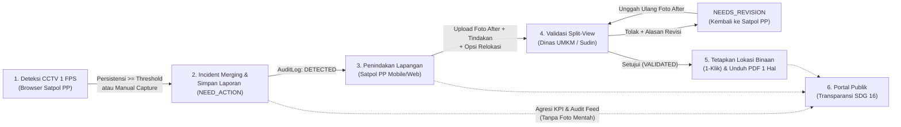
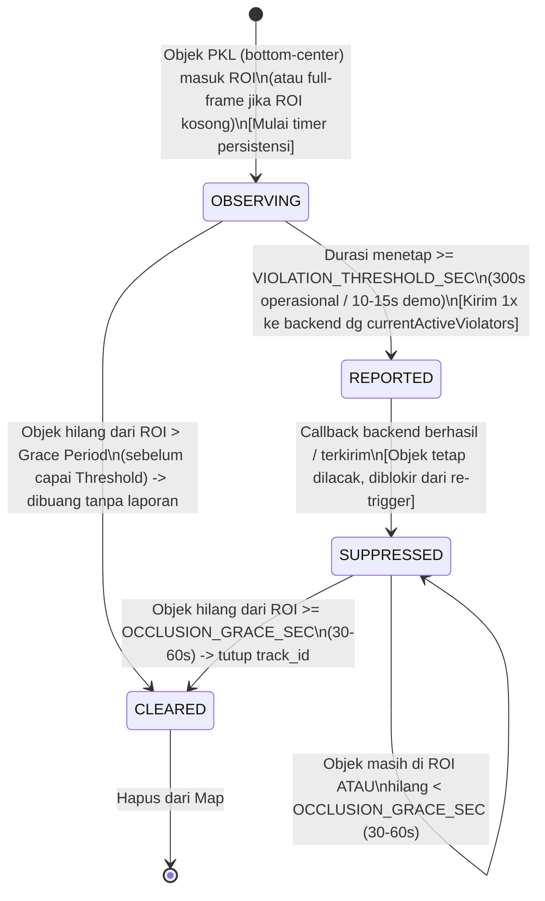

# PHASE 2 — PRODUCT & REQUIREMENT SPECIFICATION (PRD)

> **Produk:** `PATRA (Pantauan Transparan Ruang Publik)`  
> **Target Kompetisi:** Web Application Competition — Techcomfest 2027 (Deadline: 18 Desember 2026)  
> **Sub-Tema & SDG:** Sub-Tema 1 — *Smart Governance & Public Service* | **SDG 16 — Peace, Justice, and Strong Institutions**  
> **Dokumen Terkait:** [legacy_audit.md](./legacy_audit.md) (Phase 1) | [system_flow_redesign.md](./system_flow_redesign.md) (Phase 5 Revision) | [data_contract.md](../.agent/rules/data_contract.md)  
> **Status Dokumen:** Phase 5 Revised — Kontrak Kapasitas, Tim Kecamatan (`PatrolTeam`), & 4-Tier Relocation Disetujui

> [!NOTE]
> **Revisi Phase 5 (Disetujui User):** Menindaklanjuti masukan bimbingan dosen, kebutuhan fungsional diperluas dengan: (1) pemecahan akun `SATPOL_PP` per Tim & Kecamatan (*Hard-Lock* kecamatan via `PatrolTeam`), (2) penambahan kapasitas agregat Lokasi Binaan (`maxCapacity`, `occupiedCapacity`, *effective available capacity*) dengan mencabut larangan kuota lama, (3) penentuan relokasi otomatis sejak awal berbasis **4 Tingkat Waterfall** (*Nearest -> Whole-Group Fallback -> Split Fallback -> Unaccommodated Escalation*) melalui tabel `ReportRelocationAllocation`, serta (4) penguatan fungsi **Controlling & Monitoring** pada portal Dinas UMKM / Sudin PPKUKM. Rincian arsitektur dan kontrak berada di [system_flow_redesign.md](./system_flow_redesign.md) dan [data_contract.md](../.agent/rules/data_contract.md).

---

## 1. Product Overview

### 1.1 Deskripsi Produk (`LOCKED DECISION`)
**PATRA (Pantauan Transparan Ruang Publik)** adalah platform web *civic-tech* berbasis pemantauan CCTV publik *real-time* (dengan inferensi AI ringan di browser) yang menghubungkan **Satpol PP**, **Dinas Koperasi, UMKM & Perdagangan** (atau **Suku Dinas PPKUKM** di DKI Jakarta), dan **Masyarakat Publik** dalam satu siklus tata kelola penertiban serta penataan Pedagang Kaki Lima (PKL) yang transparan, manusiawi, dan dapat diaudit (*checks and balances*).

### 1.2 Problem Statement & Keterkaitan SDG 16 (`LOCKED DECISION`)
Penertiban PKL di ruang publik Indonesia (trotoar, bahu jalan, zona terlarang) menghadapi tiga masalah tata kelola klasik yang melemahkan kepercayaan publik (**SDG 16**):
1. **Ketidaktransparanan & Persepsi Tebang Pilih:** Publik tidak mengetahui kapan pelanggaran terdeteksi, seberapa cepat aparat merespons (*SLA*), atau apakah penertiban dilakukan secara adil di semua ruas jalan.
2. **Ketiadaan *Checks and Balances* Lintas Instansi:** Satpol PP bertindak di lapangan tanpa verifikasi independen dari instansi pembina (Dinas UMKM), sehingga tidak ada jejak audit permanen (*before-after*) maupun jalur terstruktur untuk mengarahkan PKL ke **Lokasi Binaan Resmi**.
3. **Beban Infrastruktur Tinggi untuk Pemda:** Solusi AI CCTV konvensional menuntut server GPU mahal dan *streaming ingestion* 24/7 yang tidak realistis bagi mayoritas Pemerintah Kabupaten/Kota.

**Solusi PATRA:**
- Memanfaatkan katalog **CCTV publik pemda yang sudah ada** (*pre-synced* ke database) dengan **inferensi AI client-side (YOLO26n ONNX @ 1 FPS)** sehingga nol biaya server GPU.
- Menerapkan mekanisme ***checks and balances* dua instansi**: Satpol PP menindak & mengunggah bukti *After* + opsi relokasi → Dinas UMKM memvalidasi *split-view* *Before-After* & menetapkan Lokasi Binaan → seluruh jejak waktu dipublikasikan ke **Portal Publik** (tanpa foto mentah demi privasi) dan dicatat permanen pada **`AuditLog` *append-only***.

### 1.3 Target Pasar B2G Bertahap (`LOCKED DECISION`)
- **Primary Beachhead (Tahap 1):** Pemerintah Kabupaten/Kota di seluruh Indonesia (fokus demo pada kota-kota di Pulau Jawa, khususnya **Kota Jakarta Pusat / DKI Jakarta** dan **Kota Semarang**) dengan 2 instansi utama:
  1. **Satpol PP** (eksekutor lapangan & pemantau CCTV).
  2. **Dinas Koperasi, UMKM & Perdagangan** (atau **Suku Dinas PPKUKM** khusus wilayah DKI Jakarta — label nama instansi pada UI & PDF menyesuaikan profil `Region` akun yang login).
- **Scale-Up (Tahap 2 — Pasca-MVP):** Pemerintah Provinsi sebagai agregator pemantauan SLA & kinerja lintas kabupaten/kota.

### 1.4 Tujuan & Success Metrics (`TECHNICAL ASSUMPTION` / `RECOMMENDATION`)
| Dimensi | Metrik Keberhasilan (Target MVP & Demo Juri) | Cara Pengukuran |
| :--- | :--- | :--- |
| **Akuntabilitas Publik (SDG 16)** | 100% perubahan status laporan tercatat di `AuditLog` *append-only* dan tampil di *Public Audit Feed* tanpa mengekspos foto mentah. | Verifikasi DB & uji Portal Publik. |
| **Kecepatan Akses & Kinerja** | Halaman katalog CCTV memuat `< 1,5 detik` (*lazy load* tanpa memuat video); inferensi AI stabil pada **1 FPS** (`≤ 400 ms/frame` di desktop standar) tanpa membekukan UI. | Lighthouse / DevTools Performance (`NEEDS VERIFICATION`). |
| **Reliabilitas Demo Live** | 0 *error* fatal saat stream CCTV publik *offline*/terkena CORS: **auto-fallback dalam ≤ 5 detik** ke Mode Simulasi dengan status transparan. | Pengujian QA simulasi *network block* & stream mati. |
| **Anti-Spam & Akurasi Insiden** | 0 laporan duplikat untuk `camera_id` yang sama selama masih ada tiket `NEED_ACTION`; objek melintas `< VIOLATION_THRESHOLD_SEC` menghasilkan 0 laporan. | Unit test *Tracker State Machine* & integration test backend. |
| **Usabilitas Mobile Lapangan** | Petugas Satpol PP dapat menyelesaikan form unggah foto *After* di layar mobile (`360px–430px`) dalam `≤ 60 detik`. | QA responsivitas & *usability test*. |

### 1.5 Scope & Strict Out-of-Scope (`LOCKED DECISION`)
**In-Scope (MVP Terkunci):**
1. **Portal Publik (Tanpa Login):** Filter Kota dinamis, 4 KPI *real-time*, Peta Transparansi (poligon zona, *hotspot* tanpa foto mentah, pin Lokasi Binaan), Linimasa Akuntabilitas, serta Halaman Login + Panel Akses Demo 1-Klik.
2. **Portal Satpol PP (Region-Locked, 3 Menu Inti):** (1) Pantauan CCTV + Pemutar Live Stream & AI Canvas, (2) Peta Wilayah Operasional (3 layer + kelola poligon zona), (3) Laporan & Penindakan (1 halaman tunggal + sub-halaman detail & form *After* mobile-responsive + Kartu Asisten Edukasi & Relokasi).
3. **Portal Dinas UMKM / Sudin PPKUKM (Region-Locked, 3 Menu Inti):** (1) Dashboard Analitik & Peta Penataan (tanpa pin CCTV), (2) Validasi Laporan *Split-View* + Penetapan Relokasi 1-Klik + Unduh Berita Acara PDF 1 Halaman, (3) CRUD Data Lokasi Binaan (*click-to-pin*, tanpa kuota).

**Strict Out-of-Scope (DILARANG KERAS DIMASUKKAN KE DESAIN/KODE):**
1. **TIDAK ADA** fitur blur wajah pada antarmuka internal pemerintah (Satpol PP & Dinas).
2. ~~**TIDAK ADA** fitur tracking kuota/kapasitas sisa lapak pada Lokasi Binaan.~~ *(DICABUT pada Revisi Phase 5 — digantikan tracking kapasitas agregat `maxCapacity` & `occupiedCapacity` per Lokasi Binaan; namun **TETAP DILARANG** membuat sistem manajemen kios/nomor lapak individual, booking mandiri PKL, atau penagihan retribusi harian).*
3. **TIDAK ADA** menu "Antrean Tiket Aktif" terpisah di Satpol PP.
4. **TIDAK ADA** panel "Live Alert" di sisi kanan halaman pemutar video CCTV.
5. **TIDAK ADA** server AI Python terpisah, GPU server, FFmpeg *ingestion worker*, atau *Message Queue* (Redis/RabbitMQ/Kafka).
6. **TIDAK ADA** penggunaan template UI jadi.

---

## 2. Role & Permission Matrix (`LOCKED DECISION`)

Setiap akun instansi terikat secara ketat pada **1 Kabupaten/Kota (`city` / `regionId`)** yang ditegakkan oleh middleware otorisasi di backend (*Region-Locked Authorization*).

| Kapabilitas / Resource | Portal Publik (Guest) | Satpol PP (Region-Locked) | Dinas UMKM / Sudin (Region-Locked) |
| :--- | :---: | :---: | :---: |
| Akses Beranda Transparansi, KPI, Peta Publik & Audit Feed (lintas kota via filter) | Baca (semua kota, **tanpa foto mentah**) | Baca (via halaman publik) | Baca (via halaman publik) |
| Login Standar & 1-Click Demo Access | Ya | Ya (logout/ganti akun) | Ya (logout/ganti akun) |
| Melihat Daftar & Live Stream CCTV + AI Detection | Tidak | **Ya (hanya `city` sendiri)** | Tidak |
| Memicu *Auto-Capture* / *Manual Capture* Laporan Pelanggaran | Tidak | **Ya (hanya kamera `city` sendiri)** | Tidak |
| Mengelola Poligon Zona Terlarang (Create/Edit/Delete) | Baca (di Peta Publik) | **CRUD (hanya `city` sendiri)** | Baca (di analitik) |
| Melihat Daftar & Detail Laporan (termasuk foto *Before* & *After*) | Tidak (publik hanya lihat alamat, waktu, status) | **Ya (hanya `city` sendiri)** | **Ya (hanya `city` sendiri)** |
| Mengunggah Hasil Penindakan (*After*, jenis tindakan, pengajuan relokasi) | Tidak | **Ya (saat status `NEED_ACTION` / `NEEDS_REVISION`)** | Tidak |
| Memvalidasi Laporan (`VALIDATED`) atau Meminta Revisi (`NEEDS_REVISION`) | Tidak | Tidak | **Ya (saat status `PENDING_VALIDATION`)** |
| Menetapkan Arahan Lokasi Binaan (1-Klik) & Unduh Berita Acara PDF 1 Halaman | Tidak | Baca hasil arahan (PDF opsional baca jika sudah valid: *default* tombol utama di Dinas) | **Ya (saat `VALIDATED`)** |
| Mengelola Data Lokasi Binaan Resmi (CRUD + *click-to-pin*) | Baca (Pin di Peta Publik) | Baca (otomatis 2–3 terdekat di Kartu Asisten) | **CRUD (hanya `city` sendiri)** |
| Menghapus / Mengubah Entri `AuditLog` | **Dilarang** | **Dilarang** (*append-only*) | **Dilarang** (*append-only*) |

> **Catatan `TECHNICAL ASSUMPTION` — Label Instansi Dinamis:** Nama instansi yang ditampilkan pada *header*, navigasi, dan kop PDF membaca kolom `umkmAgencyName` pada entitas `Region` (contoh: `"Suku Dinas PPKUKM Jakarta Pusat"` untuk DKI Jakarta, `"Dinas Koperasi dan UKM Kota Semarang"` untuk Kota Semarang).

---

## 3. Feature Specifications (Per Portal & Menu)

### 3.1 Portal Publik (Tanpa Login)

#### `FEAT-PUB-01` — Beranda Transparansi Publik (`Must`)
- **User Story:** Sebagai warga/juri, saya ingin memantau kinerja penertiban dan penataan PKL per kabupaten/kota secara transparan tanpa perlu login, sehingga saya dapat menilai kecepatan respon dan keadilan tata kelola pemerintah daerah.
- **Main Flow:**
  1. Pengguna membuka `/` dan sistem memuat daftar kota yang tersedia secara dinamis dari katalog `CctvCamera` / `Region` (default: kota pilot pertama, mis. `Kota Jakarta Pusat`, disertai opsi `"Semua Kota"` atau pilihan kota seperti `Kota Semarang`).
  2. Pengguna memilih Kabupaten/Kota pada *dropdown* filter.
  3. Sistem menampilkan **4 Kartu KPI *real-time*** untuk kota terpilih:
     - Total Pelanggaran Terdeteksi (Bulan Ini)
     - Tingkat Penyelesaian (*Resolution Rate* % = `VALIDATED / Total Laporan * 100%`)
     - Rata-Rata Waktu Respon Penindakan (*SLA* = rata-rata durasi `createdAt` → `actionSubmittedAt`)
     - Total PKL Diarahkan ke Lokasi Binaan (jumlah laporan `VALIDATED` dengan penetapan relokasi / akumulasi PKL diarahkan)
  4. Pengguna berinteraksi dengan **Peta Transparansi Interaktif** (Leaflet) yang menampilkan: (a) poligon zona terlarang, (b) titik *hotspot* pelanggaran (klik pin → pop-up hanya berisi nama jalan/alamat, waktu deteksi, jumlah PKL terdeteksi, dan status penanganan — **tanpa foto mentah**), dan (c) pin **Lokasi Binaan Resmi** (nama, alamat, kategori dagangan, fasilitas — tanpa kuota).
  5. Pengguna menelusuri **Linimasa Akuntabilitas (*Public Audit Feed*)**: daftar kronologis per ruas jalan menampilkan jejak waktu `Deteksi -> Tindak Satpol PP -> Validasi Dinas` beserta durasi SLA.
- **Alternative / Error Flow:**
  - *Kota belum memiliki laporan bulan ini:* Kartu KPI menampilkan `0` / `-` (untuk SLA) dengan *empty state* informatif pada Linimasa; Peta tetap menampilkan Zona & Lokasi Binaan kota tersebut.
  - *API publik lambat / gagal:* Tampilkan *skeleton loader* lalu *banner* error ringan + tombol *"Muat Ulang"*.
- **Acceptance Criteria:**
  - Filter kota otomatis memperbarui KPI, Peta, dan Linimasa dalam satu siklus query.
  - Respon API publik (`GET /api/public/*`) **tidak pernah menyertakan** field `beforeImageUrl`, `afterImageUrl`, maupun URL foto mentah apa pun.
  - Responsif pada desktop (`≥ 1024px`) dan mobile (`360px+`).

#### `FEAT-PUB-02` — Halaman Login & Panel Akses Demo 1-Klik (`Must`)
- **User Story:** Sebagai petugas instansi atau juri kompetisi, saya ingin masuk menggunakan kredensial instansi atau melalui tombol akses demo 1-klik agar dapat langsung menguji alur Satpol PP maupun Dinas UMKM tanpa repot registrasi.
- **Main Flow:**
  1. Pengguna membuka `/login`.
  2. Pengguna melihat form login standar (`Email` & `Kata Sandi` dengan toggle lihat sandi) serta **Panel Akses Demo 1-Klik** berisi tombol pintas jelas:
     - *Masuk Demo: Satpol PP — Kota Jakarta Pusat* (dan/atau *Kota Semarang*)
     - *Masuk Demo: Sudin PPKUKM — Kota Jakarta Pusat* (dan/atau *Dinas UMKM — Kota Semarang*)
  3. Pengguna mengisi form atau mengklik salah satu tombol Demo 1-Klik.
  4. Backend memverifikasi kredensial (atau akun demo terdaftar di server), menerbitkan sesi autentikasi valid, lalu frontend mengarahkan ke portal sesuai role (`/satpol/cctv` atau `/dinas/dashboard`).
- **Alternative / Error Flow:**
  - *Email/password salah:* Tampilkan pesan error generik *"Email atau kata sandi tidak sesuai"* (HTTP 401), tanpa membocorkan apakah email terdaftar.
  - *Sesi sudah aktif saat membuka `/login`:* Redirect otomatis ke dashboard role yang sesuai.
  - *Demo 1-Klik:* Tombol memanggil endpoint khusus `POST /api/auth/demo-login` dengan `demoKey` (bukan menaruh password plaintext di bundle JS frontend).
- **Acceptance Criteria:**
  - Password tidak pernah dicetak di `console.log` maupun disimpan di `localStorage`.
  - Pengguna yang login langsung terkunci pada `city` milik akunnya.

---

### 3.2 Role 1: Satpol PP (Region-Locked — Hanya 3 Menu Inti)

#### `FEAT-SPP-01` — Menu 1: Pantauan CCTV (Grid Katalog Lazy-Load) (`Must`)
- **User Story:** Sebagai petugas Satpol PP, saya ingin melihat daftar seluruh kamera CCTV aktif di kota saya secara cepat tanpa membebani jaringan, lalu memilih satu kamera untuk dipantau dengan deteksi AI.
- **Main Flow:**
  1. Petugas membuka `/satpol/cctv`.
  2. Backend membaca katalog `CctvCamera` dari Supabase PostgreSQL khusus `city === req.user.city` (dengan `Cache-Control: s-maxage=900, stale-while-revalidate=60`).
  3. Halaman menampilkan ringkasan jumlah kamera aktif kota tersebut, filter pencarian nama/kecamatan/kategori fasilitas, serta *grid* kartu kamera (hanya metadata, *thumbnail* statis/placeholder, kecamatan, status ROI/laporan aktif — **stream HLS belum dimuat**).
  4. Petugas mengklik satu kartu kamera → berpindah ke `/satpol/cctv/:cameraId`.
- **Alternative / Error Flow:**
  - *Petugas mencoba mengakses URL `/satpol/cctv/:cameraId` milik kota lain:* Backend mengembalikan HTTP `403 Forbidden`; frontend menampilkan pesan akses ditolak & tombol kembali ke daftar kamera kotanya.
  - *Hasil pencarian kosong:* Tampilkan *empty state* + tombol reset filter.
- **Acceptance Criteria:**
  - Network tab memastikan 0 permintaan `.m3u8`/`.ts` saat berada di halaman *grid* daftar kamera.
  - Hanya kamera yang memiliki `city` sesuai akun login yang ditampilkan.

#### `FEAT-SPP-02` — Sub-Halaman Pemutar Live Stream CCTV & AI Canvas (`Must`)
- **User Story:** Sebagai petugas Satpol PP, saya ingin memantau *live stream* CCTV secara lebar penuh dengan *overlay* deteksi AI `PKL` dan batas ROI trotoar, sehingga pelanggaran yang menetap otomatis terekam sebagai bukti laporan tanpa spam.
- **Main Flow:**
  1. Saat halaman `/satpol/cctv/:cameraId` terbuka, komponen `<CctvPlayerWithAI />` memuat `playback_url` (fallback `stream_url`) via `hls.js` dengan `crossOrigin="anonymous"`.
  2. Video tampil **lebar penuh** (`#0B132B` frame, tanpa panel "Live Alert" di sisi kanan dan tanpa elemen ilustrasi menutupi video).
  3. Di atas video terpasang `<canvas>` *overlay* yang menggambar:
     - *Bounding box* deteksi `PKL` beserta *confidence score* dan status tracker (`OBSERVING` / `REPORTED` / `SUPPRESSED`).
     - Garis putus-putus batas **Poligon ROI Trotoar** (jika kamera memiliki `roi_polygon`).
  4. Di area kontrol video tersedia:
     - Toggle **AI Detection (ON/OFF)** (default: ON).
     - Toggle **Show ROI Trotoar (ON/OFF)** (default: ON; hanya menyembunyikan visual garis, **tidak** mematikan logika evaluasi ROI di balik layar).
     - Tombol **Fullscreen**.
  5. **1 Bar Aksi Bersih di Bawah Video** menampilkan:
     - Indikator status deteksi *real-time*: Status Aman (*0 PKL di ROI*) atau Peringatan (*N PKL di ROI + durasi persistensi maksimal*).
     - Indikator mode sumber video (*LIVE HLS* atau lencana *"Live CCTV Offline — Mode Simulasi"*).
     - Tombol **"Tangkap Bukti & Buat Laporan"** (*manual capture*).
  6. Ketika objek di dalam ROI melewati `VIOLATION_THRESHOLD_SEC` (operasional: 300 detik / mode demo: 10–15 detik), sistem mengambil *snapshot* frame video, mengirimnya ke backend, dan menampilkan *toast notification* (*"Bukti pelanggaran tersimpan ke Laporan & Penindakan"*).
- **Alternative / Error Flow:**
  - *Stream HLS gagal dalam 5 detik / CORS error / Tainted Canvas (`SecurityError`):* Pemutar otomatis beralih ke video simulasi MP4 lokal (`public/videos/...`) dan menampilkan lencana status transparan **"Live CCTV Offline — Mode Simulasi"**; inferensi AI 1 FPS tetap berjalan normal.
  - *Kamera belum memiliki `roi_polygon`:* Sistem menggunakan *full-frame* sebagai area pantauan tanpa *error*, dan toggle ROI menampilkan catatan *"Area Penuh (Full-Frame)"*.
  - *User menekan "AI Detection OFF":* Loop inferensi berhenti dan timer observasi di-pause/reset dengan aman; video tetap berjalan.
  - *User berpindah halaman / menutup kamera:* Instance `hls.js` dan interval 1 FPS dibersihkan (*cleanup*), sementara state tracker terisolasi di `Map<camera_id, CameraTracker>`.
- **Acceptance Criteria:**
  - Tidak ada panel "Live Alert" di sebelah kanan video dan tidak ada ilustrasi yang menutupi frame video.
  - Toggle `Show ROI Trotoar OFF` hanya menyembunyikan garis poligon di canvas, sementara objek di luar ROI tetap tidak dianggap melanggar.
  - Auto-capture dan manual capture sama-sama memunculkan *toast notification* yang jelas dan terhubung ke menu *Laporan & Penindakan*.

#### `FEAT-SPP-03` — Menu 2: Peta Wilayah (Peta Operasional) (`Must`)
- **User Story:** Sebagai petugas Satpol PP, saya ingin melihat sebaran kamera CCTV, poligon zona terlarang, dan titik pelanggaran aktif di kota saya dalam satu peta operasional agar bisa memprioritaskan patroli dan mengelola zona terlarang.
- **Main Flow:**
  1. Petugas membuka `/satpol/peta`.
  2. Peta Leaflet menampilkan pusat koordinat kota akun login dengan **3 layer** (beserta kontrol toggle layer):
     - **Layer 1 — Pin Kamera CCTV:** Klik pin → pop-up berisi nama kamera, kecamatan, kategori fasilitas, dan tombol **"Buka Live CCTV"** (mengarah ke `/satpol/cctv/:cameraId`).
     - **Layer 2 — Poligon Zona Terlarang:** Menampilkan area terlarang kota terkait + panel/toolbar kelola poligon zona (Tambah Poligon via klik titik di peta, Edit nama/koordinat, Hapus).
     - **Layer 3 — Pin Pelanggaran Aktif (`NEED_ACTION` & `NEEDS_REVISION`):** Klik pin → pop-up ringkas (alamat, jumlah PKL, status, waktu deteksi) + tombol **"Tindak Lanjuti"** (mengarah ke `/satpol/laporan/:reportId`).
- **Alternative / Error Flow:**
  - *Poligon baru memiliki `< 3` titik atau saling berpotongan (*self-intersecting*):* Backend (`Turf.js`) menolak dengan HTTP 400 dan frontend menampilkan pesan validasi sebelum tersimpan.
  - *Koordinat kamera berstatus `coords_exact: false`:* Pop-up menampilkan keterangan halus *"Perkiraan titik lokasi kamera"* agar transparan.
- **Acceptance Criteria:**
  - Ketiga layer dapat ditampilkan bersama maupun di-filter; hanya data milik `city` akun yang muncul.
  - Kelola poligon zona langsung tersinkron ke Peta Publik & Peta Operasional.

#### `FEAT-SPP-04` — Menu 3: Laporan & Penindakan (1 Halaman Tunggal + Detail & Form *After*) (`Must`)
- **User Story:** Sebagai petugas Satpol PP (termasuk di lapangan melalui ponsel), saya ingin melihat semua laporan pelanggaran dalam 1 halaman terfilter, melihat rekomendasi Lokasi Binaan terdekat saat mengedukasi PKL, serta mengunggah foto bukti *After* dan meneruskan permintaan relokasi ke Dinas UMKM.
- **Main Flow:**
  1. Petugas membuka `/satpol/laporan` (1 halaman tunggal gabungan tugas & riwayat — **tidak ada** menu "Antrean Tiket Aktif" terpisah).
  2. Tersedia tab/filter status: `Perlu Ditindak` (`NEED_ACTION`), `Menunggu Validasi Dinas` (`PENDING_VALIDATION`), `Perlu Revisi` (`NEEDS_REVISION`), `Tervalidasi` (`VALIDATED`), serta pencarian ruas jalan/kamera.
  3. Petugas mengklik satu laporan → membuka sub-halaman `/satpol/laporan/:reportId` (**wajib mobile-responsive**):
     - **Banner Alasan Revisi** (tampil mencolok jika status `NEEDS_REVISION`, menampilkan catatan resmi dari Dinas UMKM).
     - **Bukti Foto *Before*** (tangkapan CCTV + *timestamp* WIB + jumlah PKL terdeteksi + nama kamera/alamat) dan **Audit Log Permanen** kronologis.
     - **Kartu Asisten Edukasi & Relokasi:** Otomatis menampilkan **2–3 Lokasi Binaan Terdekat** di kota yang sama berdasarkan jarak koordinat (nama, alamat, jarak dalam km/m, kategori dagangan, fasilitas — **tanpa kuota**) + ringkasan panduan edukasi persuasif.
     - **Form Upload Hasil Akhir Penertiban** (aktif jika status `NEED_ACTION` atau `NEEDS_REVISION`):
       - Upload atau ambil langsung **Foto Bukti *After*** dari kamera ponsel (`accept="image/*" capture="environment"`).
       - Pilih **Jenis Tindakan**: `Edukasi & Himbauan`, `Penertiban Administratif`, atau `Pendampingan Relokasi`.
       - Input **Estimasi Jumlah PKL Aktual** (integer `≥ 0`, prefill dari `detectedCount`).
       - Input **Catatan Edukasi / Lapangan** (teks wajib singkat).
       - Checkbox opsional: **`PKL bersedia diarahkan ke Lokasi Binaan terdekat (Teruskan ke Dinas UMKM)`**.
  4. Petugas menekan **"Kirim Hasil Penindakan"** → foto dikompresi di klien bila > 1,5 MB, diunggah ke backend + Supabase Storage, status laporan berubah ke `PENDING_VALIDATION`, dan entri baru dicatat permanen di `AuditLog`.
- **Alternative / Error Flow:**
  - *Foto After belum dipilih atau ukuran > 4 MB setelah kompresi:* Form menolak submit dengan pesan jelas sebelum memanggil API.
  - *Koneksi seluler putus saat unggah:* Tampilkan pesan error dengan state input tetap tersimpan (tidak ter-reset) + tombol *"Coba Kirim Lagi"*.
  - *Kota belum punya Lokasi Binaan:* Kartu Asisten menampilkan panduan edukasi persuasif + catatan *"Belum ada data Lokasi Binaan terdaftar di kota ini"*.
- **Acceptance Criteria:**
  - Tidak ada fitur blur wajah pada foto *Before*/*After* di halaman internal ini.
  - Kartu Asisten tidak menampilkan informasi kuota/kapasitas lapak.
  - Seluruh elemen form dapat diakses nyaman pada viewport `360×800` tanpa *horizontal scroll*.

---

### 3.3 Role 2: Dinas UMKM / Suku Dinas PPKUKM (Region-Locked — Hanya 3 Menu Inti)

#### `FEAT-UMK-01` — Menu 1: Dashboard Analitik & Peta Penataan (`Must`)
- **User Story:** Sebagai admin Dinas UMKM / Sudin PPKUKM, saya ingin menganalisis tren pelanggaran, jam rawan, ruas jalan prioritas, dan membandingkan sebaran titik pelanggaran valid terhadap Lokasi Binaan resmi agar kebijakan penataan ruang berbasis data.
- **Main Flow:**
  1. Admin membuka `/dinas/dashboard`.
  2. Halaman menampilkan **4 KPI Strategis** (khusus `city` akun):
     - Total Laporan Masuk
     - Persentase Tervalidasi (`%`)
     - Rata-Rata SLA Respon Satpol PP (jam/menit)
     - Total Kasus Diarahkan ke Lokasi Binaan
  3. Halaman menampilkan 3 visualisasi analitik (Recharts):
     - **Grafik Tren Pelanggaran** (harian/mingguan 30 hari terakhir).
     - **Grafik Jam Paling Rawan (*Peak Hours*)** (agregasi 00:00–23:00 WIB).
     - **Daftar Top 5 Ruas Jalan / Lokasi Paling Rawan**.
  4. **Peta Penataan & Evaluasi (Leaflet):** Menampilkan **Heatmap / Titik Akumulasi Pelanggaran Valid (`VALIDATED`)** yang ditumpuk langsung dengan **Pin Lokasi Binaan Resmi** di kota tersebut. **TIDAK menampilkan pin kamera CCTV.**
- **Alternative / Error Flow:**
  - *Belum ada laporan `VALIDATED`:* Grafik & daftar menampilkan *empty state* bersih; Peta tetap menampilkan Pin Lokasi Binaan.
- **Acceptance Criteria:**
  - Pin kamera CCTV tidak dimuat maupun dirender pada Peta Penataan Dinas UMKM.
  - Seluruh angka KPI dan grafik konsisten dengan data terfilter `city` akun login.

#### `FEAT-UMK-02` — Menu 2: Validasi Laporan (*Checks & Balances Audit*), Relokasi 1-Klik & PDF (`Must`)
- **User Story:** Sebagai admin Dinas UMKM, saya ingin mengaudit bukti foto *Before* vs *After* dari Satpol PP secara objektif, menyetujui atau meminta revisi, menetapkan Lokasi Binaan terdekat dalam 1 klik, dan mengunduh Berita Acara PDF 1 halaman sebagai dokumen resmi.
- **Main Flow:**
  1. Admin membuka `/dinas/validasi`.
  2. Tersedia filter daftar laporan: `Menunggu Validasi` (`PENDING_VALIDATION`), `Ada Pengajuan Relokasi` (`relocationRequested = true`), `Tervalidasi` (`VALIDATED`), `Ditolak / Revisi` (`NEEDS_REVISION`).
  3. Admin membuka salah satu laporan → **Workspace Validasi *Split-View*** (`/dinas/validasi/:reportId`):
     - **Panel Kiri (Before — CCTV):** Foto bukti *Before*, *timestamp* deteksi WIB, nama kamera/lokasi, jumlah PKL terdeteksi.
     - **Panel Kanan (After — Satpol PP):** Foto bukti *After*, *timestamp* penindakan WIB, durasi SLA respon, jenis tindakan, estimasi jumlah PKL aktual, catatan edukasi, dan lencana pengajuan relokasi (jika dicentang Satpol PP).
     - **Riwayat `AuditLog` Permanen** di bagian bawah.
  4. **Aksi Audit (saat status `PENDING_VALIDATION`):**
     - **Setujui (Valid):** Mengubah status menjadi `VALIDATED`, mencatat `validatedAt` & `AuditLog`.
     - **Tolak / Minta Revisi:** Membuka dialog wajib isi **Alasan Revisi** (min. 10 karakter) → mengubah status menjadi `NEEDS_REVISION` dan mencatat alasan permanen di `AuditLog`.
  5. **Penetapan Arahan Relokasi (1-Klik):** Jika status `VALIDATED` dan `relocationRequested === true` (dan belum ditetapkan), sistem otomatis menampilkan **3 Lokasi Binaan Terdekat** (nama, alamat, jarak, kategori, fasilitas — **tanpa kuota**). Admin memilih 1 lokasi → klik **"Tetapkan Lokasi Relokasi"** → tersimpan pada laporan & dicatat di `AuditLog`.
  6. **Unduh Berita Acara PDF 1 Halaman:** Setelah status `VALIDATED`, tombol **"Unduh Berita Acara & Arahan Relokasi (PDF 1 Halaman)"** aktif → memanggil `GET /api/reports/:id/pdf` yang men-stream dokumen PDF 1 halaman (identitas laporan & instansi kota, foto *Before-After*, ringkasan jejak waktu `AuditLog` + SLA, dan arahan Lokasi Binaan jika ada).
- **Alternative / Error Flow:**
  - *Admin menolak tanpa mengisi alasan revisi:* Tombol konfirmasi nonaktif + pesan validasi wajib isi.
  - *Gagal mengunduh salah satu gambar saat generate PDF:* PDFKit tetap menghasilkan dokumen PDF 1 halaman dengan kotak placeholder keterangan *"Gambar tidak dapat dimuat"* + tautan bukti, tidak mengembalikan HTTP 500.
- **Acceptance Criteria:**
  - Tombol Setujui/Tolak tidak muncul lagi setelah laporan berstatus `VALIDATED`.
  - PDF yang dihasilkan muat rapi dalam **1 halaman A4** dengan stempel waktu `Asia/Jakarta` (WIB).
  - Tidak ada fitur blur wajah dan tidak ada informasi kuota pada kartu 3 Lokasi Binaan.

#### `FEAT-UMK-03` — Menu 3: Data Lokasi Binaan (CRUD) (`Must`)
- **User Story:** Sebagai admin Dinas UMKM, saya ingin mengelola daftar Lokasi Binaan resmi di kota saya lengkap dengan titik koordinat peta agar selalu akurat digunakan oleh Satpol PP, Portal Publik, dan penetapan relokasi.
- **Main Flow:**
  1. Admin membuka `/dinas/lokasi-binaan`.
  2. Halaman menampilkan peta sebaran Lokasi Binaan kota terkait + tabel/daftar Lokasi Binaan.
  3. **Tambah / Edit Lokasi Binaan:** Admin mengisi `Nama Lokasi`, `Alamat Lengkap`, memilih koordinat via ***click-to-pin* di peta** (otomatis mengisi `lat`/`lng`), `Kategori Dagangan` (mis. Kuliner, Kerajinan, Serba Ada), dan `Fasilitas` (mis. Listrik, Air Bersih, Toilet, Parkir) — **tanpa kolom kuota/kapasitas**.
  4. **Hapus Lokasi Binaan:** Menghapus (atau menonaktifkan secara aman jika sudah pernah direferensikan laporan `VALIDATED` — lihat `BR-008`).
- **Alternative / Error Flow:**
  - *Admin mencoba menghapus Lokasi Binaan yang sudah terikat pada Berita Acara/Laporan `VALIDATED`:* Sistem melakukan *soft-archive* (`isActive = false`) agar histori laporan & PDF lama tetap utuh tanpa *broken reference*.
- **Acceptance Criteria:**
  - Perubahan CRUD langsung tercermin di Peta Publik, Peta Penataan Dinas, dan perhitungan jarak terdekat di Satpol PP/Validasi.

---

## 4. User Journey & State Machines (Mermaid)

### 4.1 End-to-End User Journey (`LOCKED DECISION`)

### 4.2 Report Lifecycle State Machine (`LOCKED DECISION`)

```mermaid
stateDiagram-v2
    [*] --> NEED_ACTION : Auto-Capture (REPORTED) / Manual Capture\n[AuditLog: REPORT_CREATED]

    NEED_ACTION --> NEED_ACTION : Auto-Capture tambahan pd camera_id sama\n(currentActiveViolators > detectedCount)\n[Update Peak Count & Before Snapshot;\nAuditLog: INCIDENT_ESCALATED simpan URL lama]

    NEED_ACTION --> PENDING_VALIDATION : Satpol PP submit Foto After & Tindakan\n[Incident aktif kamera DITUTUP; mulai Cooldown;\nAuditLog: ACTION_SUBMITTED]

    PENDING_VALIDATION --> NEEDS_REVISION : Dinas UMKM Tolak (wajib alasan)\n[AuditLog: REVISION_REQUESTED]

    NEEDS_REVISION --> PENDING_VALIDATION : Satpol PP perbaiki & submit Foto After baru\n[AuditLog: REVISION_SUBMITTED]

    PENDING_VALIDATION --> VALIDATED : Dinas UMKM Setujui (Valid)\n[AuditLog: REPORT_VALIDATED]

    VALIDATED --> VALIDATED : Dinas Tetapkan Lokasi Relokasi (1-Klik)\n[AuditLog: RELOCATION_ASSIGNED]

    VALIDATED --> [*] : Siklus Selesai (PDF 1 Halaman Siap Unduh)
```

### 4.3 Client-Side Object Tracker State Machine (Per `camera_id`) (`LOCKED DECISION`)

---

## 5. Functional & Non-Functional Requirements

### 5.1 Functional Requirements (`FR-xxx`)

| ID | Kategori | Spesifikasi Fungsional Teruji | Prioritas |
| :--- | :--- | :--- | :---: |
| `FR-001` | Portal Publik | Sistem menyediakan filter dinamis berdasarkan daftar `city` yang aktif pada katalog `CctvCamera`/`Region`. | Must |
| `FR-002` | Portal Publik | Sistem menghitung dan menampilkan 4 KPI *real-time* per kota: Total Pelanggaran Bulan Ini, *Resolution Rate* (%), Rata-Rata SLA Respon Satpol PP, dan Total PKL Diarahkan ke Lokasi Binaan. | Must |
| `FR-003` | Portal Publik | Peta Transparansi Publik menampilkan Poligon Zona Terlarang, titik *hotspot* pelanggaran (hanya alamat, waktu, jumlah PKL, status — **tanpa foto mentah**), dan Pin Lokasi Binaan Resmi (tanpa kuota). | Must |
| `FR-004` | Portal Publik | Linimasa Akuntabilitas (*Public Audit Feed*) menampilkan jejak waktu penanganan per ruas jalan (`Deteksi -> Tindak -> Validasi`) bersumber dari `AuditLog` yang telah disaring untuk konsumsi publik. | Must |
| `FR-005` | Auth & RBAC | Sistem menyediakan autentikasi berbasis email & kata sandi (hash bcrypt) serta **Panel Akses Demo 1-Klik** yang menerbitkan sesi valid untuk akun demo Satpol PP dan Dinas UMKM kota pilot. | Must |
| `FR-006` | Auth & RBAC | Middleware backend wajib mengunci seluruh query & mutasi data instansi berdasarkan `user.city` (`Region-Locked`) dan `user.role` (`SATPOL_PP` / `DINAS_UMKM`), mengembalikan HTTP `403` jika terjadi akses lintas kota/role. | Must |
| `FR-007` | Katalog CCTV | Backend menyajikan daftar metadata `CctvCamera` dari Supabase PostgreSQL (hasil *pre-sync* skrip Python `indonesia_sources.py`, bukan *live scraping*) khusus `city` akun login dengan header `Cache-Control: s-maxage=900, stale-while-revalidate=60`. | Must |
| `FR-008` | Pemutar CCTV | Halaman *grid* kamera hanya memuat metadata & *thumbnail*; *stream* HLS baru dimuat (*lazy loading*) ketika pengguna membuka sub-halaman 1 kamera menggunakan `playback_url` dengan fallback `stream_url`. | Must |
| `FR-009` | Pemutar CCTV | Jika stream HLS gagal dimuat dalam **5 detik** atau terjadi error jaringan/CORS/*tainted canvas*, pemutar otomatis beralih ke video MP4 CCTV lokal dengan lencana *"Live CCTV Offline — Mode Simulasi"*. | Must |
| `FR-010` | AI & ROI | Browser menjalankan inferensi model **YOLO26n (`best.onnx`)** melalui `onnxruntime-web` (WebGPU → WASM fallback) dengan *frame sampling* **1 FPS** khusus pada kamera yang sedang dibuka, menggambar *bounding box* `PKL` + *confidence score* pada canvas video. | Must |
| `FR-011` | AI & ROI | Sistem mengevaluasi titik tengah bawah *bounding box* `((x1+x2)/2, y2)` terhadap Poligon ROI ternormalisasi `(0..1, 0..1)`. Jika `roi_polygon` kosong/null, sistem otomatis memakai *full-frame*. Toggle **Show ROI Trotoar** hanya mengatur visibilitas visual garis tanpa mematikan evaluasi ROI. | Must |
| `FR-012` | AI Tracker | *Centroid/IoU Tracker* di browser terisolasi per `camera_id` (`Map<camera_id, CameraTracker>`) dan menjalankan State Machine `OBSERVING -> REPORTED -> SUPPRESSED -> CLEARED` dengan `VIOLATION_THRESHOLD_SEC` (operasional 300s / demo 10–15s) dan *occlusion grace period* (30–60s). | Must |
| `FR-013` | Auto & Manual Capture | Ketika objek masuk state `REPORTED` (auto) atau petugas menekan **"Tangkap Bukti & Buat Laporan"** (manual), frontend menangkap snapshot frame video (JPEG terkompresi) + `currentActiveViolators`, mengirimkannya ke backend, dan menampilkan *toast notification*. | Must |
| `FR-014` | Incident Merging | Backend menerapkan **1 laporan aktif (`NEED_ACTION`) per `camera_id`** menggunakan aturan *Peak Active Count* (`Math.max`), memperbarui `detectedCount` & `beforeImageUrl` hanya jika `currentActiveViolators` meningkat, sambil menyimpan URL snapshot lama pada `AuditLog`. | Must |
| `FR-015` | Peta Satpol PP | Peta Wilayah Operasional Satpol PP menampilkan 3 layer (Pin CCTV → tombol "Buka Live CCTV", Poligon Zona Terlarang + CRUD poligon validasi Turf.js, Pin Pelanggaran Aktif → tombol "Tindak Lanjuti"). | Must |
| `FR-016` | Laporan Satpol PP | Menu *Laporan & Penindakan* berupa 1 halaman tunggal dengan filter status (`NEED_ACTION`, `PENDING_VALIDATION`, `NEEDS_REVISION`, `VALIDATED`). | Must |
| `FR-017` | Penindakan Satpol PP | Sub-halaman detail laporan menampilkan banner alasan revisi (bila ada), foto *Before*, `AuditLog`, **Kartu Asisten Edukasi & Relokasi** (2–3 Lokasi Binaan Terdekat tanpa kuota), serta form upload foto *After*, jenis tindakan, estimasi PKL aktual, catatan edukasi, dan checkbox pengajuan relokasi. | Must |
| `FR-018` | Analitik Dinas | Menu *Dashboard Analitik & Peta Penataan* Dinas UMKM menampilkan 4 KPI Strategis, Grafik Tren, Grafik *Peak Hours*, Top 5 Ruas Jalan Rawan, dan Peta Penataan (Heatmap/Akumulasi Pelanggaran Valid + Pin Lokasi Binaan, **tanpa Pin CCTV**). | Must |
| `FR-019` | Validasi Dinas | Menu *Validasi Laporan* menyediakan filter (`Menunggu Validasi`, `Ada Pengajuan Relokasi`, `Tervalidasi`, `Ditolak/Revisi`) dan Workspace *Split-View* *Before* vs *After* dengan aksi **Setujui (Valid)** dan **Tolak / Minta Revisi** (wajib alasan). | Must |
| `FR-020` | Relokasi & PDF | Pada laporan `VALIDATED` dengan `relocationRequested = true`, sistem menampilkan 3 Lokasi Binaan Terdekat (jarak koordinat, tanpa kuota) untuk penetapan 1-klik, dan menyediakan unduhan **Berita Acara & Arahan Relokasi (PDF 1 Halaman)** berbasis PDFKit streaming. | Must |
| `FR-021` | Lokasi Binaan CRUD | Menu *Data Lokasi Binaan* memungkinkan Dinas UMKM menambah, mengubah, mengarsipkan/menghapus Lokasi Binaan (nama, alamat, koordinat via *click-to-pin*, kategori dagangan, fasilitas — tanpa kuota) beserta peta sebarannya. | Must |
| `FR-022` | Audit Trail | Setiap perubahan siklus laporan (`REPORT_CREATED`, `INCIDENT_ESCALATED`, `ACTION_SUBMITTED`, `REVISION_REQUESTED`, `REVISION_SUBMITTED`, `REPORT_VALIDATED`, `RELOCATION_ASSIGNED`) wajib menulis baris baru pada tabel `AuditLog` yang bersifat *append-only* (tanpa endpoint UPDATE/DELETE). | Must |

### 5.2 Non-Functional Requirements (`NFR-xxx`)

| ID | Aspek | Target & Batasan Teknis | Status Verifikasi |
| :--- | :--- | :--- | :---: |
| `NFR-001` | **Performa & Lazy Load** | Halaman *grid* CCTV tidak memuat video HLS; *bundle* awal tidak memblokir render dengan mengunduh `best.onnx` sebelum pengguna membuka halaman pemutar CCTV. | `NEEDS VERIFICATION` |
| `NFR-002` | **Efisiensi Inferensi 1 FPS** | Inferensi ONNX berjalan pada interval 1 FPS dengan *in-flight lock*, *reused canvas/Float32Array*, serta `dispose()` input & output tensor agar tidak terjadi *memory leak* selama pemantauan panjang. | `NEEDS VERIFICATION` |
| `NFR-003` | **Batas Serverless Vercel** | Ukuran payload unggah gambar ke `apps/api` wajib dikompresi di klien menjadi `≤ 1,5 MB` (batas keras Multer `4 MB`, aman di bawah limit `4,5 MB` Vercel Functions). Koneksi DB wajib via Supabase Transaction Pooler (`port 6543`) + batch `$transaction([...])`. | `NEEDS VERIFICATION` |
| `NFR-004` | **Privasi Publik** | Portal Publik dan endpoint `/api/public/*` dilarang mengirim URL foto bukti (*Before*/*After*) atau data identitas pribadi petugas/pedagang. | `LOCKED DECISION` |
| `NFR-005` | **Keamanan Aplikasi** | Password di-hash dengan `bcryptjs`, token sesi memakai JWT bertanda tangan (`HS256`, expiry wajar), seluruh payload divalidasi dengan `Zod`, *CORS* dibatasi pada origin frontend terdaftar, dan label peta disanitasi dari XSS. | `LOCKED DECISION` |
| `NFR-006` | **Responsivitas & Desain Kustom** | UI kustom (Tailwind CSS + shadcn/ui, bebas template) mengikuti palet Cobalt Blue `#043FA5`, Cool Horizon `#73A6E9`, surface `#FFFFFF`, canvas `#F4F7FC`, dark video `#0B132B`, font Plus Jakarta Sans & JetBrains Mono; 100% responsif desktop & mobile (`360px`–`1440px+`). | `LOCKED DECISION` |
| `NFR-007` | **Zona Waktu Konsisten** | Seluruh tampilan jam, grafik *Peak Hours*, dan PDF Berita Acara diformat konsisten dalam zona waktu **`Asia/Jakarta` (WIB)**, meskipun server Vercel berjalan di UTC. | `TECHNICAL ASSUMPTION` |

---

## 6. Business Rules & Edge Cases

### 6.1 Business Rules (`BR-xxx`)

- **`BR-001` — Incident-Based Merging (1 Laporan Aktif per `camera_id`) (`LOCKED DECISION`):**
  Saat `POST /api/reports/auto-detect` menerima sinyal dari kamera `camera_id` dengan nilai `currentActiveViolators >= 1`:
  1. Cek apakah ada `ViolationReport` dengan `cameraId = camera_id` dan `status = 'NEED_ACTION'`.
  2. **Jika ADA:** Jangan buat laporan baru. Bandingkan `currentActiveViolators` terhadap `activeReport.detectedCount`:
     - Jika `currentActiveViolators > activeReport.detectedCount`:
       - Simpan `activeReport.beforeImageUrl` lama dan nilai `detectedCount` lama pada `metadata` entri `AuditLog` baru (`action: 'INCIDENT_ESCALATED'`).
       - Unggah snapshot terbaru ke Supabase Storage, lalu perbarui `activeReport.detectedCount = currentActiveViolators` dan `activeReport.beforeImageUrl = newSnapshotUrl`.
       - Kembalikan HTTP `200 OK` dengan flag `merged: true, escalated: true`.
     - Jika `currentActiveViolators <= activeReport.detectedCount`:
       - **Abaikan pembaruan snapshot** (jangan unggah file baru ke Supabase Storage dan jangan tulis `AuditLog` baru agar tidak spam).
       - Kembalikan HTTP `200 OK` dengan `activeReport` yang ada dan flag `merged: true, escalated: false`.
  3. **Jika TIDAK ADA:** Periksa aturan *cooldown* (`BR-002`). Jika lolos, unggah snapshot, buat `ViolationReport` baru berstatus `NEED_ACTION`, tulis `AuditLog` (`action: 'REPORT_CREATED'`), dan kembalikan HTTP `201 Created`.

- **`BR-002` — Penutupan *Incident* & Masa *Cooldown* per Kamera (`RECOMMENDATION` / `TECHNICAL ASSUMPTION`):**
  - Suatu *incident* aktif pada `camera_id` dianggap **tertutup** segera setelah status laporan berpindah dari `NEED_ACTION` → `PENDING_VALIDATION` (saat Satpol PP mengirim foto *After*).
  - Setelah *incident* ditutup, diterapkan **masa *cooldown* per kamera** terhitung dari `actionSubmittedAt` laporan terakhir pada `camera_id` tersebut:
    - Mode Operasional: **`CAMERA_COOLDOWN_SEC = 900` (15 menit)**.
    - Mode Demo / Penjurian: **`CAMERA_COOLDOWN_SEC = 30` (30 detik)** agar juri dapat mendemokan siklus baru dengan cepat tanpa menunggu lama.
  - Selama masa *cooldown*, sinyal *auto-detect* pada `camera_id` tersebut dikembalikan dengan HTTP `200 OK` (`suppressedByCooldown: true`) tanpa membuat tiket baru.
  - *Laporan berstatus `NEEDS_REVISION` tidak memblokir deteksi incident baru* karena `NEEDS_REVISION` merepresentasikan revisi dokumentasi penindakan lampau, bukan kejadian aktif baru di kamera.

- **`BR-003` — Perilaku *Manual Capture* ("Tangkap Bukti & Buat Laporan") (`RECOMMENDATION`):**
  - Jika petugas mengklik tombol *Manual Capture* saat **tidak ada** laporan `NEED_ACTION` pada kamera tersebut: langsung membuat laporan baru (`source: 'MANUAL'`, melewati *cooldown* kamera) dengan `detectedCount = Math.max(1, currentDetectedInRoi)` dan mencatat `AuditLog` (`REPORT_CREATED` oleh `actorId`).
  - Jika **sudah ada** laporan `NEED_ACTION` pada kamera tersebut: backend tetap menerapkan *Incident Merging* (memperbarui snapshot ke bukti manual terbaru & menyimpan URL bukti lama ke `AuditLog` dengan `action: 'MANUAL_EVIDENCE_UPDATED'`) lalu menampilkan *toast* *"Bukti terbaru ditambahkan ke laporan aktif pada kamera ini"* — mencegah tiket ganda sekaligus menghormati tindakan petugas.

- **`BR-004` — Perhitungan SLA & *Resolution Rate* (`TECHNICAL ASSUMPTION`):**
  - **Durasi SLA Penindakan (per laporan):** `actionSubmittedAt - createdAt` (dihitung pada *submission* penindakan pertama Satpol PP, dalam menit/jam).
  - **Rata-Rata SLA:** Rata-rata durasi SLA dari seluruh laporan yang sudah pernah ditindak (`actionSubmittedAt != null`) pada kota terkait.
  - **Resolution Rate (%):** `(Jumlah Laporan VALIDATED / Jumlah Total Laporan) * 100%` (dibulatkan 1 desimal; `0%` jika total = 0).

- **`BR-005` — Aturan Lokasi Binaan Terdekat (`LOCKED DECISION`):**
  - Dihitung menggunakan rumus jarak geografis **Haversine** (atau `@turf/distance`) dari koordinat laporan `(lat, lng)` ke seluruh `RelocationSite` dengan `city === report.city` dan `isActive === true`.
  - Mengembalikan maksimal **3 lokasi terdekat** terurut naik berdasarkan jarak (meter/km). Tidak ada perhitungan atau tampilan kuota/kapasitas.

- **`BR-006` — Syarat Validasi, Revisi & Penetapan Relokasi (`LOCKED DECISION`):**
  - Hanya laporan berstatus `PENDING_VALIDATION` yang dapat divalidasi (`VALIDATED`) atau ditolak (`NEEDS_REVISION`) oleh Dinas UMKM pada `city` yang sama.
  - Penolakan wajib menyertakan `revisionReason` (minimal 10 karakter).
  - Penetapan Lokasi Relokasi (`relocationSiteId`) hanya dapat dilakukan pada laporan `VALIDATED` yang memiliki `relocationRequested === true`, dan `RelocationSite` yang dipilih wajib berasal dari `city` yang sama.

- **`BR-007` — Immutability `AuditLog` (`LOCKED DECISION`):**
  - Tidak ada endpoint `PUT`/`PATCH`/`DELETE` untuk `AuditLog`. Setiap perubahan status atau snapshot di dalam service backend wajib menyisipkan baris `AuditLog` dalam satu batch transaksi Prisma (`prisma.$transaction([...])`).

- **`BR-008` — Penghapusan Aman Lokasi Binaan (`RECOMMENDATION`):**
  - Jika `RelocationSite` belum pernah direferensikan oleh `ViolationReport`, delete menghapus baris secara permanen; jika sudah pernah direferensikan, backend mengubah `isActive = false` (arsip lunak) agar arsip laporan & Berita Acara PDF lama tetap konsisten.

### 6.2 Edge Cases & Respons Sistem (`EC-xxx`)

| ID | Skenario *Edge Case* | Perilaku / Respons Sistem yang Wajib Diimplementasikan |
| :--- | :--- | :--- |
| `EC-001` | **CCTV *Offline*, Timeout > 5 Detik, CORS Error, atau *Tainted Canvas* (`SecurityError`)** | `hls.js` dibatasi *timeout* 5 detik. Jika stream gagal memuat, terkena error fatal CORS/jaringan, atau `ctx.getImageData()` melempar `SecurityError`, `<CctvPlayerWithAI />` otomatis memuat video MP4 CCTV lokal kota terkait, menyalakan lencana **"Live CCTV Offline — Mode Simulasi"**, dan menjalankan AI 1 FPS seperti biasa tanpa crash. |
| `EC-002` | **Frame Video Korup / Belum Siap (`videoWidth === 0` / `readyState < 2`)** | Loop inferensi 1 FPS memeriksa `video.readyState >= 2 && video.videoWidth > 0 && !video.paused`. Jika belum siap, *tick* tersebut dilewati diam-diam (*skip frame*) tanpa melempar error dan tanpa mereset state tracker. |
| `EC-003` | **Browser Di-*Refresh* Saat Objek PKL Sudah Aktif/Dilaporkan** | State tracker di memori browser ter-reset, sehingga objek akan melewati `OBSERVING -> REPORTED` ulang setelah `VIOLATION_THRESHOLD_SEC`. Saat terkirim ke backend, **`BR-001` (*Incident Merging* + *Peak Active Count*)** mendeteksi laporan `NEED_ACTION` yang masih ada pada `camera_id` tersebut; karena `currentActiveViolators <= activeReport.detectedCount`, backend mengabaikan upload snapshot baru dan **tidak terjadi duplikasi laporan maupun penghitungan ganda**. |
| `EC-004` | ***Occlusion* Sementara (Truk/Bus/Pejalan Kaki Melintas Menutupi Gerobak)** | Objek berstatus `SUPPRESSED` tidak langsung dihapus saat hilang 1–10 detik. Tracker mempertahankan `track_id` selama ***Occlusion Grace Period* (30–60 detik)**; bila gerobak muncul kembali di area dekat (*Centroid/IoU match*) sebelum *grace period* habis, status tetap `SUPPRESSED` tanpa memicu laporan ulang. |
| `EC-005` | **Kamera Belum Memiliki Konfigurasi `roi_polygon` (`null` / `< 3` titik)** | Evaluasi ROI otomatis jatuh ke mode **`FULL_FRAME`** (seluruh area video dianggap zona pantauan), toggle *Show ROI* menampilkan info *"Full-Frame"*, dan tidak ada exception di canvas. |
| `EC-006` | **Upload Foto *After* Gagal (Jaringan Putus / File > 4 MB / Format Non-Gambar)** | Frontend mengompresi gambar ke JPEG (`maxSide 1600px`, target `≤ 1,5 MB`) sebelum kirim dan memvalidasi MIME (`image/jpeg`, `image/png`, `image/webp`). Jika unggah tetap gagal (timeout/offline), form menjaga seluruh isian petugas agar tidak hilang dan menampilkan tombol *"Coba Lagi"*. |
| `EC-007` | **Revisi Berulang oleh Dinas UMKM (`PENDING_VALIDATION -> NEEDS_REVISION -> PENDING_VALIDATION`)** | Laporan dapat direvisi berulang kali. Setiap penolakan menyimpan `revisionReason` terbaru pada laporan dan mencatat seluruh riwayat revisi + foto *After* sebelumnya pada `AuditLog` sehingga jejak audit lengkap. `actionSubmittedAt` awal tetap dipertahankan sebagai basis SLA respon pertama, sementara waktu submit revisi tercatat di `AuditLog`. |
| `EC-008` | **Konflik Pembaruan Status Bersamaan (*Race Condition*)** | Seluruh transisi status menggunakan *guarded conditional update* (`updateMany` / cek `status` di dalam transaksi): • 2 petugas Satpol PP submit *After* bersamaan → request pertama menang (`200`), request kedua mendapat HTTP `409 Conflict` (*"Laporan ini sudah ditindaklanjuti oleh petugas lain"*). • 2 admin Dinas memvalidasi bersamaan → request kedua mendapat HTTP `409 Conflict` (*"Status laporan sudah berubah, muat ulang halaman"*). • *Auto-capture* masuk tepat saat Satpol PP baru saja submit *After* → karena status sudah `PENDING_VALIDATION` & masuk *cooldown* (`BR-002`), auto-capture diabaikan aman tanpa merusak laporan. |
| `EC-009` | **Inferensi ONNX Memakan Waktu > 1000 ms (Perangkat Lambat)** | Loop 1 FPS menggunakan *in-flight lock* (`isInferring`) dan `setTimeout` berantai (bukan `setInterval` buta) sehingga frame berikutnya hanya diproses setelah inferensi selesai—mencegah antrean tensor menumpuk dan menjaga UI tetap responsif. |
| `EC-010` | **Perpindahan Kamera Cepat / Multi-Tab** | Setiap kamera memiliki tracker terisolasi (`Map<camera_id, CameraTracker>`). Saat berpindah dari Kamera A ke Kamera B, stream `hls.js` Kamera A di-`destroy()` dan timer inferensi dihentikan agar tidak membocorkan bandwidth/RAM. Jika 2 tab membuka kamera yang sama, `BR-001` di backend menjamin tetap hanya 1 laporan aktif tercipta. |

---

## 7. Ringkasan Keputusan & Asumsi pada Phase 2

| Klasifikasi | Keputusan / Catatan |
| :--- | :--- |
| `LOCKED DECISION` | Seluruh arsitektur 3 portal (Publik, Satpol PP 3 menu, Dinas UMKM 3 menu), *region-locked* per `city`, *auto-fallback* 5 detik, 1 FPS ONNX, *ROI bottom-center*, *Tracker State Machine*, *Incident Merging Peak Active Count*, *AuditLog append-only*, dan 6 *Strict Out-of-Scope* dipatuhi 100% tanpa modifikasi. |
| `RECOMMENDATION` | Ditetapkan `CAMERA_COOLDOWN_SEC` (900s operasional / 30s demo) pasca penutupan *incident* (`NEED_ACTION -> PENDING_VALIDATION`), perilaku *Manual Capture* saat tiket aktif (update bukti + catat URL lama di `AuditLog` agar tidak duplikat tiket), serta *soft-archive* (`isActive = false`) untuk Lokasi Binaan yang sudah terikat laporan `VALIDATED`. |
| `TECHNICAL ASSUMPTION` | Nama instansi UMKM dinamis per kota (`umkmAgencyName` di tabel `Region`); SLA dihitung dari `createdAt` hingga *submission* penindakan pertama (`actionSubmittedAt`); seluruh tampilan waktu menggunakan zona `Asia/Jakarta` (WIB). |
| `NEEDS VERIFICATION` | Pengujian benchmark inferensi 1 FPS, `tainted canvas` pada stream HLS nyata, dan batas payload 4,5 MB Vercel akan diverifikasi pada Sprint 1 (akan dirinci di Phase 3 & 4). |

---

*Status Phase 2: **SELESAI — MENUNGGU TINJAUAN & PERSETUJUAN SEBELUM LANJUT KE PHASE 3 (`docs/document.md` & `docs/data_contract.md`).***
