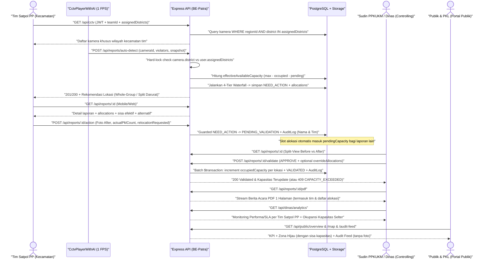
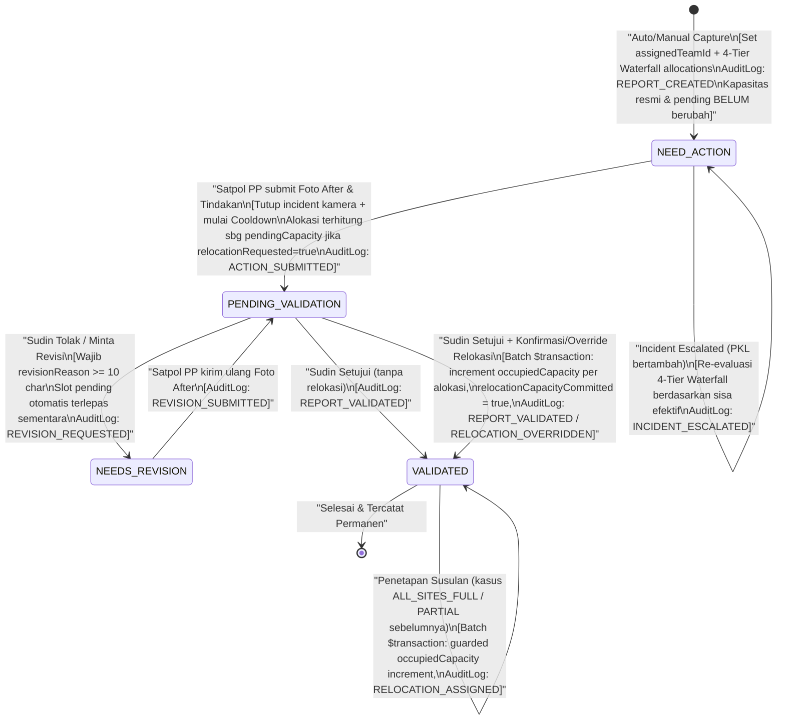

# PHASE 5 — REVISI ARSITEKTUR, ALUR SISTEM, ROLE KECAMATAN & KAPASITAS RELOKASI (`PATRA`)

> **Produk:** `PATRA (Pantauan Transparan Ruang Publik)`  
> **Status Dokumen:** `LOCKED` — Disetujui User (Siap Eksekusi P0)  
> **Dokumen Terkait:** [requirement.md](./requirement.md) | [document.md](./document.md) | [data_contract.md](../.agent/rules/data_contract.md) | [task.md](./task.md)  
> **Cakupan Fase Ini:** Fokus penuh pada perbaikan **Arsitektur Sistem, Role Management (Hard-Lock per Kecamatan), Kapasitas Lokasi Binaan + Sisa Efektif, Logika Relokasi Otomatis 4 Tingkat (Split Darurat sebagai Cara Terakhir), serta Fungsi Controlling & Monitoring Sudin**. Redesign UI Portal Publik (Masukan #1) dan pengembangan konten Panduan PKL berbasis wawancara (Masukan #5) **sengaja ditunda** ke fase berikutnya setelah alur sistem inti ini stabil.

---

## 1. Audit Arsitektur Eksisting & Temuan Kritis dari Codebase

### 1.1 Ringkasan Arsitektur Aktual
Berdasarkan inspeksi langsung terhadap `BE-Patra`, `FE-Patra`, dan `AI-Patra`, arsitektur monorepo PATRA saat ini memiliki fondasi sebagai berikut:
- **`AI-Patra/`:** Pelatihan & ekspor model YOLO26n (`best.onnx`) serta skrip pemanen katalog CCTV (`cctv_catalog/indonesia_sources.py` -> `cctv_snapshot.json`).
- **`FE-Patra/`:** React 18 + Vite + TypeScript + Tailwind + Leaflet + Recharts + `hls.js` + `onnxruntime-web` (inferensi 1 FPS *client-side* pada `<CctvPlayerWithAI />` dengan fallback MP4 5 detik). Memiliki `FE-Patra/src/services/offlineMock.ts` sebagai mode pratinjau offline yang harus tetap sinkron dengan kontrak DTO `FE-Patra/src/types/*`.
- **`BE-Patra/`:** Express 5 + TypeScript ESM + Prisma v7 (`@prisma/adapter-pg`) + Supabase PostgreSQL & Storage + Turf.js + PDFKit. Menggunakan arsitektur berlapis `routes -> middlewares -> controller -> service -> repository` dengan kontrak DTO & validasi Zod di `BE-Patra/src/interface/*`.

### 1.2 Invariant Teknis yang Wajib Dipertahankan
Seluruh revisi alur sistem **wajib mematuhi** batasan teknis arsitektur PATRA agar tidak menimbulkan regresi di produksi Vercel + Supabase:
1. **Kompatibilitas Supabase PgBouncer Transaction Pooler (`:6543`):** Dilarang menggunakan *interactive transaction* Prisma (`prisma.$transaction(async (tx) => ...)`). Semua operasi atomik wajib memakai *nested write* tunggal atau *batch array transaction* (`prisma.$transaction([...])`).
2. **Guarded Optimistic Updates (`EC-008`):** Seluruh transisi status dan pengurangan/penambahan kapasitas wajib memakai kondisi `where` yang ketat di Prisma dan menangkap `P2025` untuk mengembalikan HTTP `409 Conflict` secara deterministik tanpa *race condition*.
3. **Immutability `AuditLog` (`BR-007`):** Tabel `AuditLog` tetap bersifat *append-only* (tanpa `updatedAt` dan tanpa endpoint `UPDATE`/`DELETE`).
4. **Incident Merging (`BR-001`) & Cooldown (`BR-002`):** Tetap berlaku 1 tiket `NEED_ACTION` aktif per `cameraId` dengan aturan *Peak Active Count*, plus masa *cooldown* pasca penindakan.
5. **Privasi Publik (`NFR-004`) & Isolasi Kamera Dinas:** Endpoint publik (`/api/public/*`) dilarang keras menyertakan `beforeImageUrl`/`afterImageUrl`, dan `planningMap` Dinas/Sudin tetap tidak pernah menyertakan pin kamera CCTV.
6. **Anti-Overengineering:** Tidak membangun sistem sewa kios/retribusi harian per individu PKL, tidak memakai API routing berbayar (tetap Haversine + tautan Google Maps), dan tidak membangun server AI/message queue terpisah.

### 1.3 Tiga Temuan Nyata dari Audit Data & Kode

1. **Distribusi Kolom `district` pada Katalog CCTV (`AI-Patra/cctv_catalog/cctv_snapshot.json`):**
   Hasil audit terhadap **874 kamera** pada snapshot katalog menunjukkan ketimpangan kelengkapan metadata kecamatan:
   - **`Kota Jakarta Pusat`:** 100% kamera pada snapshot memiliki `district` (`Tanah Abang`: 22 kamera, `Menteng`: 8 kamera; ditambah 1 kamera seed di `BE-Patra/src/config/seedData.ts` pada `Gambir`).
   - **`Kota Semarang`:** Memiliki 54 kamera tersebar di 11 kecamatan (`Semarang Tengah`: 15, `Semarang Selatan`: 8, `Semarang Barat`: 6, `Banyumanik`: 4, `Pedurungan`: 4, `Candisari`: 3, `Semarang Utara`: 2, `Gajah Mungkur`: 1, `Ngaliyan`: 1, `Semarang Timur`: 1, `Tugu`: 1), **namun terdapat 8 kamera dengan `district = null`**:
     - `smg_8857_ARAH_PANDANARAN` (*ARAH PANDANARAN*)
     - `smg_7645_ARAH_TUGU_TUNAS` (*ARAH TUGU TUNAS*)
     - `smg_8872_Bundaran_Madukoro` (*Bundaran Madukoro*)
     - `smg_8713_PAHLAWAN_180` (*PAHLAWAN 180*)
     - `smg_7642_PAHLAWAN_PTZ_2` (*PAHLAWAN PTZ 2*)
     - `smg_8871_SIMPANG_WAGISAN_TAMAN_KASMAR` (*SIMPANG WAGISAN TAMAN KASMARAN*)
     - `smg_8868_SRIWIJAYA_01` (*SRIWIJAYA 01*)
     - `smg_8869_SRIWIJAYA_02` (*SRIWIJAYA 02*)
   - **19 Kota Ekstra Lainnya:** Sebanyak **527 kamera** di luar 2 kota pilot belum memiliki nilai `district` (total **535 dari 874 kamera** memiliki `district` kosong/`null`).
   - *Implikasi Desain:* Penerapan *hard-lock* per kecamatan harus memiliki mekanisme pemetaan untuk 8 kamera Semarang tersebut serta *fallback* aman untuk kota ekstra yang belum memiliki pembagian tim kecamatan agar kamera tidak menghilang.

2. **Inkonsistensi Identitas Aktor di `AuditLog` (`BE-Patra/src/service/report.service.ts`):**
   Pada `report.service.ts`, seluruh pencatatan `AuditLog` dari aksi user (`MANUAL_EVIDENCE_UPDATED`, `REPORT_CREATED` manual, `ACTION_SUBMITTED`, `REVISION_SUBMITTED`, `REPORT_VALIDATED`, `REVISION_REQUESTED`, `RELOCATION_ASSIGNED`) saat ini mengisi `actorName: user.email`, bukan nama petugas dan identitas tim/wilayahnya (`fullName` + nama tim). Hal ini menurunkan keterbacaan jejak akuntabilitas baik di UI maupun PDF Berita Acara.

3. **Celah Alur Relokasi & Ketidakseimbangan Peran Sudin (`report.service.ts` & `schema.prisma`):**
   - Model `RelocationSite` saat ini eksplisit `TANPA KUOTA`.
   - `findNearestRelocationSites` di `BE-Patra/src/service/geo.service.ts` hanya mengurutkan 3 lokasi terdekat berdasarkan Haversine saat `GET /api/reports/:id` dipanggil tanpa memeriksa daya tampung.
   - Penetapan `relocationSiteId` baru terjadi secara manual melalui `POST /api/reports/:id/relocation` **setelah** laporan berstatus `VALIDATED`. Akibatnya, saat Satpol PP menindak di lapangan (`NEED_ACTION`), sistem belum menentukan lokasi tujuan yang terjamin kapasitasnya, dan Sudin terjebak mengerjakan pemilihan lokasi manual alih-alih fokus pada fungsi **controlling dan monitoring**.

---

## 2. Desain Role Management & Hard-Lock Per Kecamatan (`PatrolTeam`)

### 2.1 Konsep Entitas Tim Patroli (`PatrolTeam`)
Untuk membedakan akun Satpol PP berdasarkan tim dan wilayah tugas tanpa merusak isolasi kota (`Region`), ditambahkan entitas **`PatrolTeam`**:
- Satu `Region` (Kota/Kabupaten) dapat memiliki banyak `PatrolTeam` (misalnya *Tim Alpha — Tanah Abang*, *Tim Bravo — Menteng & Gambir*).
- Satu `PatrolTeam` memiliki daftar kecamatan tugas pada kolom `assignedDistricts` (`Json` array string, mis. `["Tanah Abang"]` atau `["Semarang Selatan", "Candisari"]`), sehingga 1 tim dapat mengampu 1 atau beberapa kecamatan berdekatan.
- Satu `User` ber-role `SATPOL_PP` terikat pada 1 `teamId` (opsional `null` khusus akun demo kota ekstra yang belum dipetakan kecamatannya).
- Setiap `ViolationReport` yang dibuat menyimpan `assignedTeamId` (diisi otomatis saat laporan dibuat berdasarkan pencocokan `camera.district` ke `PatrolTeam.assignedDistricts` dalam region yang sama).

### 2.2 Aturan Hard-Lock Per Kecamatan (`SATPOL_PP`)
Keputusan user: **Hard-Lock per Kecamatan**.

Aturan scoping di backend (`assertCameraScope`, `assertReportScope`, `assertZoneScope`) bekerja bertingkat sebagai berikut:
1. **Level 1 — Region-Lock (Kota/Kabupaten):** Selalu wajib. `target.regionId === req.user.regionId`. Jika berbeda -> HTTP `403 REGION_ACCESS_DENIED`.
2. **Level 2 — District/Team Hard-Lock (Khusus `SATPOL_PP` dengan `assignedDistricts.length > 0`):**
   - **Katalog & Live CCTV (`GET /api/cctv`, `GET /api/cctv/:id`, `PATCH /api/cctv/:id/roi`, `POST /api/reports/auto-detect`):**
     - List kamera (`GET /api/cctv`) otomatis menyuntikkan filter `district IN user.assignedDistricts` (case-insensitive). Parameter query `district` dari klien tidak boleh memperluas akses ke luar `assignedDistricts` tim tersebut.
     - Akses detail kamera, ubah ROI, atau trigger `auto-detect` pada kamera dengan `camera.district` di luar `user.assignedDistricts` (atau `null` ketika user terikat tim kecamatan) -> ditolak dengan HTTP **`403 DISTRICT_ACCESS_DENIED`** (*"Kamera ini berada di luar wilayah kecamatan tugas tim Anda."*).
   - **Laporan & Penindakan (`GET /api/reports`, `GET /api/reports/:id`, `POST /api/reports/:id/action`, `GET /api/reports/:id/pdf`):**
     - List laporan otomatis memfilter `assignedTeamId === user.teamId` (atau jika `assignedTeamId` null pada data historis, fallback `camera.district IN user.assignedDistricts`).
     - Mengakses detail, mengirim bukti *After*, atau mengunduh PDF laporan milik kecamatan/tim lain -> ditolak dengan HTTP **`403 DISTRICT_ACCESS_DENIED`**.
   - **Zona Terlarang (`RestrictedZone`):**
     - Tambah kolom opsional `district String?` pada `RestrictedZone`.
     - `GET /api/zones` menampilkan zona pada `regionId` yang relevan (zona timnya + zona tingkat kota bila `district = null`, ditandai jelas).
     - `POST /api/zones` oleh tim berkecamatan otomatis mengisi `district = user.assignedDistricts[0]` (atau pilihan valid dari `assignedDistricts` timnya).
     - `PATCH /api/zones/:id` dan `DELETE /api/zones/:id` pada zona milik kecamatan lain ditolak dengan HTTP **`403 DISTRICT_ACCESS_DENIED`**.
3. **Fallback Aman untuk 19 Kota Ekstra (`teamId = null` / `assignedDistricts = []`):**
   - Untuk 527 kamera pada 19 kota ekstra yang belum memiliki metadata `district`, akun demo kota tersebut tidak diikat ke `PatrolTeam` (`teamId = null`). Backend tetap menegakkan *Region-Lock* tingkat kota tanpa memblokir seluruh kamera yang `district`-nya `null`.

### 2.3 Penanganan 8 Kamera Semarang dengan `district = null`
Agar pembagian tim di kota pilot **Kota Semarang** bersih dan tidak ada kamera tanpa wilayah kecamatan, 8 kamera Semarang yang `district`-nya kosong di `cctv_snapshot.json` akan dipetakan secara deterministik berdasarkan wilayah jalan saat proses normalisasi/seeding (dan diverifikasi koordinatnya terhadap batas kecamatan Kota Semarang saat implementasi P0):
- Koridor **Pahlawan / Pandanaran / Sriwijaya / Taman Kasmaran** -> dipetakan ke `Semarang Selatan` / `Semarang Tengah`.
- **Bundaran Madukoro** -> dipetakan ke `Semarang Barat`.
- **ARAH TUGU TUNAS** -> diverifikasi koordinat lat/lng-nya ke kecamatan terkait.

### 2.4 Peran Sudin PPKUKM / Dinas UMKM (`DINAS_UMKM`) — Controlling & Monitoring
Akun `DINAS_UMKM` tetap menggunakan enum role `DINAS_UMKM` (dengan label antarmuka dinamis dari `Region.umkmAgencyName`, mis. *Suku Dinas PPKUKM Jakarta Pusat*), `teamId = null`, dan memiliki **akses penuh tingkat kota (`City-Wide`)** lintas semua kecamatan untuk menjalankan fungsi:
1. **Controlling Kualitas Penindakan:** Memvalidasi kesesuaian bukti *Before vs After*, memeriksa ketepatan alokasi relokasi yang direkomendasikan/diajukan, menolak/meminta revisi (`NEEDS_REVISION`), atau melakukan **override alokasi lokasi relokasi** jika diperlukan penyesuaian di tingkat kota.
2. **Controlling Kapasitas Lokasi Binaan:** Mengelola master data `RelocationSite` beserta `maxCapacity` dan koreksi manual `occupiedCapacity`.
3. **Monitoring Lintas Tim & Wilayah:** Memantau kinerja dan SLA setiap `PatrolTeam` (perbandingan volume laporan, rata-rata SLA respon, dan persentase laporan yang dikembalikan untuk revisi) serta memantau utilisasi kapasitas seluruh lokasi binaan (mendeteksi lokasi hampir penuh/penuh, kasus `SPLIT_FALLBACK`, dan kasus `PARTIAL_UNACCOMMODATED` / `ALL_SITES_FULL`).
4. **Penerbitan Berita Acara Resmi:** Mengunduh PDF Berita Acara 1 halaman sebagai dokumen audit lintas instansi.

### 2.5 Pembaruan Payload JWT, Profil User & Format `AuditLog.actorName`
- **`JwtUserPayload` & `AuthUserDto`:** Diperluas dengan `fullName: string`, `teamId: string | null`, `teamName: string | null`, `assignedDistricts: string[]`.
- **Perbaikan `AuditLog.actorName`:** Setiap aksi user mencatat snapshot nama manusiawi, bukan email:
  - Untuk `SATPOL_PP` bertim: `"<fullName> (<teamName>)"`, mis. `"Regu Patroli 1 (Tim Tanah Abang)"`.
  - Untuk `DINAS_UMKM`: `"<fullName> (<umkmAgencyName>)"`.
  - Untuk AI: `"PATRA Vision AI (1 FPS)"`.

### 2.6 Matriks Otorisasi Lengkap

| Kapabilitas / Resource | Publik (Guest) | Satpol PP (Hard-Locked Kecamatan) | Sudin / Dinas UMKM (City-Wide Controlling & Monitoring) |
| :--- | :---: | :---: | :---: |
| Portal Publik (KPI, Peta Zona Hijau + Kapasitas, Audit Feed tanpa foto) | Baca (Semua Kota) | Baca | Baca |
| Katalog & Live Stream CCTV + AI Detection + Edit ROI | Tidak | **Ya (Hanya Kecamatan Tim)** | **Tidak** |
| Trigger `auto-detect` (Auto / Manual Capture) | Tidak | **Ya (Hanya Kamera Kecamatan Tim)** | **Tidak** |
| Zona Terlarang (`RestrictedZone`) | Baca | **CRUD Zona Kecamatan Tim** | **Baca (Semua Kecamatan Kota)** |
| Daftar & Detail Laporan Pelanggaran | Tidak | **Baca (Hanya Laporan Tim/Kecamatan)** | **Baca (Semua Tim Kota, filter `teamId`/`district`)** |
| Submit Bukti *After* & Konfirmasi Relokasi (`PENDING_VALIDATION`) | Tidak | **Ya (Hanya Laporan Kecamatan Tim)** | **Tidak** |
| Validasi *Before-After* (`VALIDATED` / `NEEDS_REVISION`) | Tidak | Tidak | **Ya (Semua Kecamatan Kota)** |
| Override Alokasi Relokasi & Commit Kapasitas | Tidak | Tidak | **Ya (Saat Validasi / Pasca Validasi jika belum commit)** |
| CRUD Lokasi Binaan + Atur `maxCapacity` & Koreksi `occupiedCapacity` | Baca (Zona Hijau) | Baca (Referensi Lapangan) | **Ya (Tingkat Kota)** |
| Dashboard Monitoring Kinerja Tim & Okupansi Kapasitas | Tidak | Tidak | **Ya (Tingkat Kota)** |
| Unduh Berita Acara PDF 1 Halaman (`VALIDATED`) | Tidak | **Ya (Hanya Laporan Kecamatan Tim)** | **Ya (Semua Kecamatan Kota)** |
| Ubah / Hapus `AuditLog` | **Dilarang** | **Dilarang** | **Dilarang** |

---

## 3. Desain Capacity Management (`RelocationSite`)

### 3.1 Pencabutan Larangan Kuota (Revisi Scope Terkontrol)
Masukan dosen #2 dan #3 mensyaratkan agar PATRA mencatat kapasitas Lokasi Binaan dan memakainya sebagai dasar penentuan relokasi. Oleh karena itu, poin *"Strict Out-of-Scope: Tidak ada tracking kuota/kapasitas"* pada `requirement.md` dan `data_contract.md` dicabut secara resmi.

**Batas Anti-Overengineering yang Tetap Dijaga:** PATRA hanya melacak kapasitas agregat per `RelocationSite` (jumlah slot PKL). PATRA **tidak** membangun tabel kios bernomor, sistem booking mandiri PKL, pencatatan identitas pribadi PKL (NIK/KTP), atau sistem pembayaran retribusi harian.

### 3.2 Model Data & Field Terhitung (*Computed DTO*) termasuk Sisa Efektif
Pada tabel `RelocationSite` ditambahkan 2 kolom integer:
- `maxCapacity Int @default(20)` — daya tampung maksimal PKL (validasi Zod: integer `>= 1` dan `<= 5000`).
- `occupiedCapacity Int @default(0)` — jumlah slot resmi yang saat ini terisi (validasi Zod: integer `>= 0` dan `occupiedCapacity <= maxCapacity`).

Pada lapisan DTO API, backend menghitung secara konsisten:
- **`availableCapacity` (Sisa Resmi):** `Math.max(0, maxCapacity - occupiedCapacity)`
- **`pendingCapacity` (Sedang Diproses / Antrean Validasi):** Agregasi dinamis `SUM(ReportRelocationAllocation.allocatedCount)` untuk seluruh laporan pada `regionId` tersebut yang berstatus `PENDING_VALIDATION` dengan `relocationRequested = true` dan `relocationCapacityCommitted = false`.
- **`effectiveAvailableCapacity` (Sisa Efektif):** `Math.max(0, maxCapacity - occupiedCapacity - pendingCapacity)` — digunakan oleh algoritma penentuan relokasi awal agar laporan paralel yang masuk beruntun tidak saling bentrok memperebutkan slot yang sama!
- **`occupancyPercent`:** `maxCapacity > 0 ? Math.min(100, Math.round((occupiedCapacity / maxCapacity) * 100)) : 100`
- **`capacityStatus`:**
  - `'FULL'` jika `availableCapacity === 0`
  - `'NEAR_FULL'` jika `availableCapacity > 0` dan `occupancyPercent >= 80`
  - `'AVAILABLE'` jika `occupancyPercent < 80`

> **Kenapa `pendingCapacity` dihitung dinamis, bukan kolom DB?** Jika disimpan di kolom terpisah, kegagalan atau penolakan revisi rawan membuat angka *pending* tidak sinkron. Menghitungnya lewat agregasi query pada laporan `PENDING_VALIDATION` menjamin angka *Sisa Efektif* selalu konsisten (*single source of truth*) dan otomatis bebas kembali begitu Sudin menolak/membatalkan relokasi.

### 3.3 Dua Jalur Pembaruan Kapasitas Resmi
1. **Jalur Otomatis (Transaksional dari Alur Relokasi PATRA):**
   - Setiap kali laporan dengan relokasi aktif resmi berstatus `VALIDATED` (dan belum pernah meng-commit kapasitas sebelumnya), `occupiedCapacity` pada setiap lokasi dalam daftar alokasi (`ReportRelocationAllocation`) bertambah secara atomik sebesar `allocatedCount` dalam batch transaksi yang sama.
2. **Jalur Koreksi Manual oleh Sudin (`PATCH /api/relocation-sites/:id`):**
   - Di lapangan, PKL bisa masuk mendaftar langsung ke Sudin di luar deteksi CCTV atau berhenti berdagang dari lokasi binaan. Sudin berhak memperbarui `maxCapacity` maupun melakukan koreksi `occupiedCapacity` secara manual melalui endpoint manajemen Lokasi Binaan.
   - Validasi integritas: Sudin tidak boleh memperkecil `maxCapacity` di bawah `occupiedCapacity` saat ini tanpa menyesuaikan `occupiedCapacity` terlebih dahulu (error `400 INVALID_CAPACITY_RANGE`).

---

## 4. Desain Automated Relocation Logic (4 Tingkat Waterfall) & State Machine Baru

### 4.1 Pemisahan Tegas: Rekomendasi Awal vs Commit Kapasitas Resmi
Untuk memenuhi masukan dosen #3 (*lokasi relokasi ditentukan sejak awal*) **tanpa** menimbulkan bug *phantom occupancy*:
- **Tahap 1 (`NEED_ACTION` — Saat Laporan Dibuat):** Sistem **menghitung dan menyimpan alokasi rekomendasi sejak awal** berdasarkan *Sisa Efektif*, namun **BELUM** memotong `occupiedCapacity` resmi.
- **Tahap 2 (`PENDING_VALIDATION` — Saat Satpol PP Menindak):** Satpol PP menerima arahan lokasi yang pasti saat mengedukasi PKL di lapangan, menginput `actualPklCount`, serta menandai `relocationRequested` (jika `actualPklCount` berubah dibanding `detectedCount` saat penindakan, sistem melakukan hitung ulang alokasi bila petugas tidak menentukan pilihan khusus). Laporan `PENDING_VALIDATION` dengan `relocationRequested = true` otomatis dihitung ke `pendingCapacity` sehingga laporan baru berikutnya langsung melihat **Sisa Efektif** terbaru.
- **Tahap 3 (`VALIDATED` — Saat Sudin Controlling & Validasi):** Sudin memverifikasi bukti *Before-After*. Jika menyetujui laporan dengan `relocationRequested = true`, Sudin mengonfirmasi alokasi tujuan (atau melakukan *override* ke lokasi lain yang tersedia), dan pada titik inilah **`occupiedCapacity` bertambah secara atomik** dengan flag pengaman `relocationCapacityCommitted = true` (mencegah *double-deduction*).

### 4.2 Model Baru `ReportRelocationAllocation` & Penambahan Field pada `ViolationReport`
Untuk mendukung *Split Darurat* (1 laporan dapat terpecah ke >1 lokasi pada kondisi terdesak) secara relasional tanpa merusak *backward compatibility* `relocationSiteId`:

- **Model Baru `ReportRelocationAllocation`:**
  - `id String @id @default(uuid())`
  - `reportId String` (FK -> `ViolationReport`, `onDelete: Cascade`)
  - `relocationSiteId String` (FK -> `RelocationSite`, `onDelete: Restrict`)
  - `allocatedCount Int` (`>= 1`)
  - `rankOrder Int @default(1)` (urutan prioritas alokasi: `1` adalah lokasi utama)
  - `isRecommended Boolean @default(true)`
  - `createdAt DateTime @default(now())`
  - `@@unique([reportId, relocationSiteId])`, `@@index([relocationSiteId])`, `@@index([reportId, rankOrder])`

- **Penambahan pada `ViolationReport`:**
  - `assignedTeamId String?` (FK -> `PatrolTeam`, `onDelete: SetNull`)
  - `recommendedRelocationSiteId String?` (FK -> `RelocationSite`, `onDelete: SetNull` — lokasi utama `rankOrder = 1` hasil rekomendasi awal)
  - `relocationMatchStatus RelocationMatchStatus?` (enum baru: `NEAREST_AVAILABLE | FALLBACK_AVAILABLE | SPLIT_FALLBACK | PARTIAL_UNACCOMMODATED | ALL_SITES_FULL`)
  - `unaccommodatedPklCount Int @default(0)` (jumlah PKL yang belum tertampung apabila total sisa efektif kota tidak mencukupi)
  - `relocationCapacityCommitted Boolean @default(false)`
  - Relasi `relocationAllocations ReportRelocationAllocation[]`
  - *Catatan `relocationSiteId`:* Tetap dipertahankan sebagai penunjuk lokasi utama (`rankOrder = 1`) saat laporan sudah ditetapkan/divalidasi agar KPI dan query ringkas eksisting tetap kompatibel.

- **Penambahan pada `AuditAction`:**
  - `RELOCATION_OVERRIDDEN` untuk mencatat secara eksplisit jika Sudin mengganti susunan alokasi/lokasi relokasi berbeda dari rekomendasi/pengajuan lapangan.

### 4.3 Algoritma Deterministik 4 Tingkat (*Waterfall*) — `selectRecommendedRelocationPlan`
Berjalan di `BE-Patra/src/service/geo.service.ts` dengan input `(lat, lng, requiredCount, activeSitesWithEffectiveCapacity)`:
1. Hitung jarak Haversine `distanceMeters` untuk seluruh `activeSites` (`isActive = true` dan `regionId` sama), lalu urutkan deterministik berdasarkan `distanceMeters ASC, name ASC`.
2. Evaluasi berjenjang berdasarkan **`effectiveAvailableCapacity`** (dari yang terbesar dampaknya di lapangan):
   - **Tingkat 1 — `NEAREST_AVAILABLE` (Terdekat Muat Penuh):**
     - Cek kandidat terdekat indeks `0`. Jika `effectiveAvailableCapacity >= requiredCount` -> alokasikan seluruh `requiredCount` ke kandidat `0` (`1` baris alokasi, `unaccommodatedPklCount = 0`).
   - **Tingkat 2 — `FALLBACK_AVAILABLE` (Opsi A: Pindah Satu Rombongan):**
     - Jika kandidat `0` tidak cukup (`effectiveAvailableCapacity < requiredCount`), cari kandidat terdekat berikutnya (`index >= 1`) yang memiliki `effectiveAvailableCapacity >= requiredCount`.
     - Jika ditemukan -> alokasikan seluruh `requiredCount` ke kandidat alternatif tersebut (tidak dipecah agar rapi di lapangan), simpan daftar lokasi yang dilewati pada `skippedFullSites`, `unaccommodatedPklCount = 0`.
   - **Tingkat 3 — `SPLIT_FALLBACK` (Split Darurat — Cara Terakhir):**
     - Jika **tidak ada satu pun** lokasi yang memiliki `effectiveAvailableCapacity >= requiredCount`, tetapi **total gabungan** `effectiveAvailableCapacity` seluruh lokasi `>= requiredCount`:
     - Lakukan iterasi berurutan dari lokasi terdekat (`index = 0, 1, ...`) selama `remaining > 0`: untuk setiap lokasi dengan `eff > 0`, ambil `take = Math.min(remaining, eff)`, tambahkan ke `allocations`, dan kurangi `remaining -= take`.
     - Contoh nyata: butuh **3 PKL**, Lokasi #1 sisa **2**, Lokasi #2 sisa **1** -> menghasilkan `[ { site: Lokasi #1, count: 2 }, { site: Lokasi #2, count: 1 } ]`, `unaccommodatedPklCount = 0`.
   - **Tingkat 4 — `PARTIAL_UNACCOMMODATED` / `ALL_SITES_FULL`:**
     - Jika total gabungan `effectiveAvailableCapacity < requiredCount`:
       - Bila total gabungan `> 0`: alokasikan semaksimal mungkin seperti Tingkat 3, sisa `unaccommodatedPklCount = remaining`, status **`PARTIAL_UNACCOMMODATED`** (memicu alert kekurangan slot di Dashboard Sudin).
       - Bila total gabungan `=== 0`: `allocations = []`, `unaccommodatedPklCount = requiredCount`, status **`ALL_SITES_FULL`** (memicu alert darurat kapasitas di Dashboard Sudin).

**Re-Evaluasi Otomatis:**
- Saat `INCIDENT_ESCALATED` (jumlah `detectedCount` bertambah di `NEED_ACTION`), algoritma dijalankan ulang dengan `requiredCount` baru dan memperbarui `ReportRelocationAllocation` (`isRecommended = true`), `recommendedRelocationSiteId`, serta `relocationMatchStatus`.
- Saat `POST /api/reports/:id/action` oleh Satpol PP (bila `relocationRequested = true` dan `actualPklCount !== detectedCount` dan petugas tidak mengirim `allocations` manual), algoritma juga menyelaraskan alokasi terhadap `actualPklCount` (jika `actualPklCount === 0`, relokasi tidak memerlukan alokasi slot).

### 4.4 Pola Transaksi Atomik Multi-Lokasi PgBouncer-Safe (`VALIDATED` + Commit Kapasitas)
Untuk menjamin tidak terjadi *overbooking* meskipun ada validasi paralel di Vercel + Supabase Pooler (`:6543`), proses `APPROVE` pada laporan dengan `relocationRequested = true` dan `finalAllocations.length > 0` dijalankan menggunakan **1 batch array `prisma.$transaction([...])`** tanpa *interactive transaction*:

```ts
// 1. Pra-verifikasi tiap site pada finalAllocations: isActive, regionId === report.regionId,
//    dan (site.maxCapacity - site.occupiedCapacity) >= alloc.allocatedCount.
// 2. Jalankan batch transaksi atomik (urutan deterministik berdasarkan relocationSiteId ASC):
const ops = [
  ...sortedAllocations.map((alloc) =>
    prisma.relocationSite.update({
      where: {
        id: alloc.relocationSiteId,
        regionId: report.regionId,
        isActive: true,
        // Guard kapasitas atomik: melempar P2025 jika request paralel baru mengisi slot
        maxCapacity: alloc.expectedMaxCapacity,
        occupiedCapacity: { lte: alloc.expectedMaxCapacity - alloc.allocatedCount },
      },
      data: {
        occupiedCapacity: { increment: alloc.allocatedCount },
      },
    }),
  ),
  prisma.reportRelocationAllocation.deleteMany({
    where: { reportId: report.id },
  }),
  prisma.reportRelocationAllocation.createMany({
    data: finalAllocations.map((alloc, idx) => ({
      reportId: report.id,
      relocationSiteId: alloc.relocationSiteId,
      allocatedCount: alloc.allocatedCount,
      rankOrder: idx + 1,
      isRecommended: !isOverridden,
    })),
  }),
  prisma.violationReport.update({
    where: {
      id: report.id,
      status: 'PENDING_VALIDATION',
      relocationCapacityCommitted: false,
    },
    data: {
      status: 'VALIDATED',
      validatedByUserId: user.sub,
      validatedAt: now,
      revisionReason: null,
      relocationSiteId: finalAllocations[0]!.relocationSiteId,
      relocationAssignedAt: now,
      relocationMatchStatus: computedMatchStatus,
      unaccommodatedPklCount: computedUnaccommodated,
      relocationCapacityCommitted: true,
    },
  }),
  prisma.auditLog.create({
    data: {
      reportId: report.id,
      actorId: user.sub,
      actorRole: 'DINAS_UMKM',
      actorName: formatActorName(user),
      action: isOverridden ? 'RELOCATION_OVERRIDDEN' : 'REPORT_VALIDATED',
      fromStatus: 'PENDING_VALIDATION',
      toStatus: 'VALIDATED',
      note: '...',
      metadata: { finalAllocations, isOverridden },
    },
  }),
];

await prisma.$transaction(ops);
```

- **Penanganan `P2025` & Anti-Deadlock:**
  - Pengurutan `sortedAllocations` berdasarkan `relocationSiteId ASC` mencegah deadlock saat dua laporan *split* menyentuh pasangan lokasi yang sama.
  - Jika salah satu guard gagal (`P2025`), PostgreSQL melakukan *rollback* penuh seluruh batch. Service mengecek apakah status laporan berubah (`409 REPORT_STATUS_CONFLICT`) atau kapasitas baru saja tidak cukup (`409 CAPACITY_EXCEEDED` disertai saran alokasi hitung ulang terbaru).
- **Backward Compatibility `POST /api/reports/:id/relocation`:**
  - Tetap dipertahankan khusus untuk kasus susulan (`status === 'VALIDATED'`, `relocationRequested === true`, `relocationCapacityCommitted === false`, mis. sebelumnya `ALL_SITES_FULL` / `PARTIAL_UNACCOMMODATED` lalu Sudin menambah kapasitas/lokasi baru). Menggunakan pola batch transaksi atomik yang sama.
- **Soft-Archive Safety (`BR-008`):**
  - `RelocationSiteRepository.countReferencingReports(id)` wajib menghitung referensi di `ViolationReport` (`relocationSiteId` / `recommendedRelocationSiteId`) **dan** `ReportRelocationAllocation` (`relocationSiteId`) sebelum melakukan hard delete vs soft-archive (`isActive = false`).

### 4.5 Diagram Alur Sistem & State Machine Baru

#### A. End-to-End Sequence Diagram (Setelah Revisi)



#### B. State Machine Siklus Laporan & Kapasitas



---

## 5. Desain Monitoring & Controlling Sudin (`GET /api/dinas/analytics` & `GET /api/reports`)

Untuk mewujudkan peran Sudin sebagai **controller dan monitor**, kontrak data analitik dan daftar laporan diperluas secara *backward-compatible*:

1. **Perluasan `DinasAnalyticsData` (`GET /api/dinas/analytics`):**
   - Pertahankan seluruh field lama (`kpi`, `dailyTrend`, `peakHoursWib`, `topHotspotStreets`, `planningMap`).
   - Tambahkan field kapasitas pada `planningMap.relocationSites[]` (`maxCapacity`, `occupiedCapacity`, `pendingCapacity`, `availableCapacity`, `effectiveAvailableCapacity`, `occupancyPercent`, `capacityStatus`).
   - Tambahkan objek **`capacityOverview`**:
     - `totalSites`, `totalMaxCapacity`, `totalOccupiedCapacity`, `totalPendingCapacity`, `totalAvailableCapacity`.
     - `nearFullSitesCount`, `fullSitesCount`.
     - `splitRelocationReportsCount`: jumlah laporan yang mengalami `SPLIT_FALLBACK`.
     - `unaccommodatedPklTotal`: total `unaccommodatedPklCount` pada laporan aktif/tervalidasi yang belum tertampung (indikator kebijakan ekspansi selter).
   - Tambahkan array **`teamPerformance[]`** (agregasi per `PatrolTeam` di region terkait):
     - `teamId`, `teamCode`, `teamName`, `assignedDistricts`.
     - `totalReports`, `needActionCount`, `pendingValidationCount`, `needsRevisionCount`, `validatedCount`.
     - `avgResponseSlaMinutes` (kecepatan respon tim).
     - `revisionRatePercent` (persentase laporan tim yang pernah/sedang `NEEDS_REVISION` sebagai indikator kualitas pembinaan lapangan).

2. **Perluasan Filter Daftar Laporan Sudin (`GET /api/reports`):**
   - Khusus role `DINAS_UMKM`, query `GET /api/reports` mendukung parameter opsional `teamId` dan `district` agar Sudin bisa memantau dan mengaudit antrean laporan per tim maupun per kecamatan.
   - Untuk role `SATPOL_PP`, parameter `teamId`/`district` dari klien tetap diabaikan atau dibatasi agar tidak bisa menembus *hard-lock* kecamatannya.

---

## 6. Rancangan Perubahan Prisma Schema & API Contract Delta

Seluruh delta di bawah ini telah disinkronkan secara lengkap ke [.agent/rules/data_contract.md](../.agent/rules/data_contract.md).

### 6.1 Ringkasan Delta Prisma (`BE-Patra/prisma/schema.prisma`)

| Model / Enum | Perubahan yang Ditetapkan | Keterangan |
| :--- | :--- | :--- |
| **`RelocationMatchStatus`** *(Enum Baru)* | `NEAREST_AVAILABLE`, `FALLBACK_AVAILABLE`, `SPLIT_FALLBACK`, `PARTIAL_UNACCOMMODATED`, `ALL_SITES_FULL` | Status hasil pencocokan 4 tingkat waterfall. |
| **`AuditAction`** *(Enum)* | Tambah `RELOCATION_OVERRIDDEN` | Mencatat saat Sudin mengganti alokasi relokasi dari rekomendasi/pengajuan lapangan. |
| **`PatrolTeam`** *(Model Baru)* | `id`, `regionId` (FK `Region`), `code` (`@unique`), `name`, `assignedDistricts` (`Json`), `isActive`, `createdAt`, `updatedAt` | Unit tim patroli Satpol PP per wilayah kecamatan. |
| **`ReportRelocationAllocation`** *(Model Baru)* | `id`, `reportId` (FK `ViolationReport`), `relocationSiteId` (FK `RelocationSite`), `allocatedCount`, `rankOrder`, `isRecommended`, `createdAt` | Mendukung relokasi tunggal maupun *Split Darurat* multi-lokasi dengan alokasi jumlah PKL pasti per lokasi. |
| **`User`** | Tambah `teamId String?` (FK -> `PatrolTeam`, `onDelete: SetNull`), index `[regionId, role, teamId]` | Mengikat akun Satpol PP ke tim & wilayah tugasnya. |
| **`RestrictedZone`** | Tambah `district String?`, index `[regionId, district, isActive]` | Mendukung hard-lock CRUD zona per kecamatan. |
| **`RelocationSite`** | Tambah `maxCapacity Int @default(20)`, `occupiedCapacity Int @default(0)` | Pengelolaan daya tampung PKL (mengganti catatan *tanpa kuota*). |
| **`ViolationReport`** | Tambah `assignedTeamId String?`, `recommendedRelocationSiteId String?`, `relocationMatchStatus RelocationMatchStatus?`, `unaccommodatedPklCount Int @default(0)`, `relocationCapacityCommitted Boolean @default(false)` | Routing tim penanggung jawab, rekomendasi sejak awal, sisa tak tertampung, dan pengaman anti double-commit kapasitas. |

### 6.2 Ringkasan Delta Kontrak REST API

| Endpoint | Perubahan Kontrak |
| :--- | :--- |
| `POST /api/auth/login`, `POST /api/auth/demo-login`, `GET /api/auth/me` | `user` menyertakan `team: { id, code, name, assignedDistricts } \| null`. |
| `GET /api/cctv`, `GET /api/cctv/:id`, `PATCH /api/cctv/:id/roi` | Untuk `SATPOL_PP` bertim, otomatis tersaring / *hard-locked* ke `assignedDistricts` (`403 DISTRICT_ACCESS_DENIED`). |
| `POST /api/reports/auto-detect` | Memvalidasi *hard-lock* kecamatan kamera; otomatis mengisi `assignedTeamId`, `recommendedRelocationSiteId`, `relocationMatchStatus`, `unaccommodatedPklCount`, serta `ReportRelocationAllocation`; mengembalikan ringkasan rencana relokasi awal. |
| `GET /api/reports` | `SATPOL_PP` otomatis terkunci ke tim/kecamatan; `DINAS_UMKM` mendapat dukungan filter `teamId` & `district`. |
| `GET /api/reports/:id` | Menyertakan `assignedTeam`, `recommendedRelocationSiteId`, `recommendedRelocationSiteName`, `relocationMatchStatus`, `unaccommodatedPklCount`, `relocationAllocations[]`, serta metrik kapasitas (`maxCapacity`, `occupiedCapacity`, `pendingCapacity`, `availableCapacity`, `effectiveAvailableCapacity`, `capacityStatus`) pada `nearestRelocationSites[]`. |
| `POST /api/reports/:id/action` | Input opsional `allocations` (`[{ relocationSiteId, allocatedCount }]`); `AuditLog.actorName` memakai format `"Nama (Tim)"`. |
| `POST /api/reports/:id/validate` | Input saat `decision === 'APPROVE'` mendukung opsional `overrideAllocations` (`[{ relocationSiteId, allocatedCount }]`); jika `relocationRequested = true`, transaksi batch otomatis memotong kapasitas per alokasi (`409 CAPACITY_EXCEEDED` bila baru penuh). |
| `POST /api/reports/:id/relocation` | Tetap tersedia khusus kasus susulan (`VALIDATED` yang belum `relocationCapacityCommitted`); mendukung `relocationSiteId` (tunggal) atau `allocations` melalui batch transaksi atomik yang sama. |
| `GET /api/dinas/analytics` | Menambah `capacityOverview`, `teamPerformance[]`, dan metrik kapasitas pada `planningMap.relocationSites[]`. |
| `GET/POST/PATCH /api/relocation-sites` | Menyertakan `maxCapacity`, `occupiedCapacity`, `pendingCapacity`, `availableCapacity`, `effectiveAvailableCapacity`, `occupancyPercent`, `capacityStatus`. |
| `GET /api/public/map` | Menyertakan metrik kapasitas pada `relocationSites[]` (tetap **tanpa foto mentah**). |

### 6.3 Rancangan Data Demo Kota Pilot (Untuk Uji & Presentasi Dosen)
Agar seluruh skenario baru dapat didemokan secara nyata pada 2 kota pilot:
- **Kota Jakarta Pusat (`jkt-pusat`):**
  - `PatrolTeam`: **Tim Alpha — Tanah Abang** (`["Tanah Abang"]`), **Tim Bravo — Menteng & Gambir** (`["Menteng", "Gambir"]`).
  - Akun Demo: `satpol-jkp-tanah-abang`, `satpol-jkp-menteng-gambir`, dan `dinas-jkt-pusat` (Sudin PPKUKM Jakarta Pusat).
  - *Skenario Fallback & Split:* Setel **Lokasi Binaan JP 37 Thamrin City** penuh (`maxCapacity: 25, occupiedCapacity: 25`) sehingga laporan di Tanah Abang otomatis beralih ke **Sentra Binaan Kebon Kacang Raya** (`FALLBACK_AVAILABLE`), atau memicu `SPLIT_FALLBACK` bila kapasitas Kebon Kacang disetel sisa sedikit.
- **Kota Semarang (`semarang`):**
  - `PatrolTeam`: **Tim Tengah — Semarang Tengah** (`["Semarang Tengah"]`), **Tim Selatan & Barat — Koridor Kota** (`["Semarang Selatan", "Semarang Barat", "Candisari", "Gajah Mungkur", "Banyumanik", "Semarang Utara", "Semarang Timur", "Pedurungan", "Ngaliyan", "Tugu"]`).
  - Akun Demo: `satpol-smg-tengah`, `satpol-smg-selatan-barat`, dan `dinas-semarang`.
  - *Skenario Fallback:* Setel **Sentra Kuliner PKL Simpang Lima** dalam status `FULL` (`occupiedCapacity === maxCapacity`) agar skenario fallback bekerja di kedua kota pilot.

---

## 7. Peta Dokumen & Urutan Eksekusi (*Stop-Gate Checklist*)

- [x] **Gerbang 1: Review & Persetujuan Alur Bisnis (`docs/system_flow_redesign.md`)** — Disetujui user (Hard-Lock kecamatan, Sudin Controlling/Monitoring, Kapasitas + Sisa Efektif, 4-Tier Waterfall dengan Split Darurat sebagai cara terakhir).
- [x] **Gerbang 2: Pembaruan Dokumen Kontrak & Spesifikasi** — Disinkronkan ke [.agent/rules/data_contract.md](../.agent/rules/data_contract.md), [requirement.md](./requirement.md), dan [document.md](./document.md).
- [ ] **Gerbang 3: Implementasi Bertahap (`P0 -> P1` Alur Inti, Baru Kemudian UI Publik & Panduan)**
  - **Sprint Revisi A (P0 — Fondasi DB, Role Kecamatan & Kapasitas):** Migrasi Prisma (`PatrolTeam`, `ReportRelocationAllocation`, kapasitas `RelocationSite`, kolom relokasi di `ViolationReport`), pemetaan `district` 8 kamera Semarang, seed data baru, auth/JWT + middleware *hard-lock* kecamatan, CRUD kapasitas Sudin, serta unit test RBAC & kapasitas.
  - **Sprint Revisi B (P1 — Logika Relokasi 4-Tier, Controlling & Monitoring):** `selectRecommendedRelocationPlan`, transaksi atomik commit kapasitas di `validate` & `relocation`, update PDF Berita Acara, endpoint analitik `teamPerformance` & `capacityOverview`, pembaruan UI portal internal Satpol PP & Sudin + `offlineMock.ts`, dan integration test *race condition* (`409 CAPACITY_EXCEEDED`).
  - **Sprint Revisi C (Fase Berikutnya — UI Portal Publik & Panduan PKL):** Redesign UI Portal Publik (Masukan #1) dan pembaruan menu Panduan PKL berbasis hasil wawancara PKL (Masukan #5).
